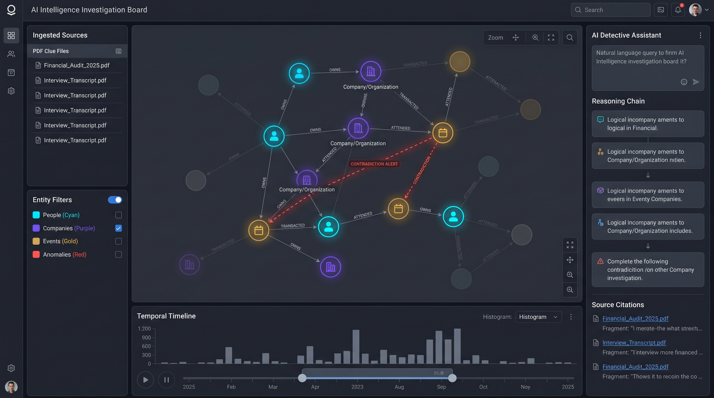
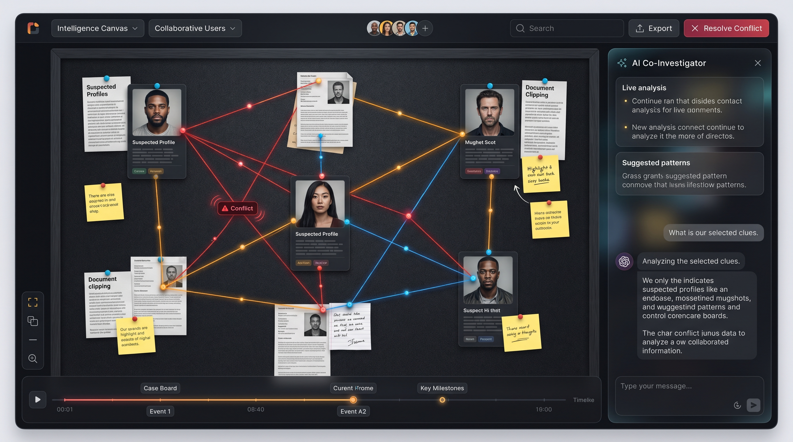
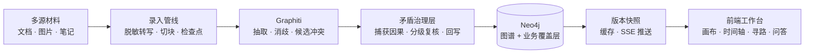

# InvestigationWorkBench

**InvestigationWorkBench** 是一款基于**时态知识图谱（Temporal Knowledge Graph）**与**图谱检索增强问答**的交互式 AI 情报调查工作台。产品打破传统线性对话框范式，通过 **「空间图谱画布 + 时间轴回放 + 可信度驱动的矛盾治理」**，帮助分析师从海量、碎片化且存在真伪冲突的跨时间材料中，快速还原事件脉络、锁定逻辑漏洞，并生成句句可溯源的研判结论。

> **本地优先**：服务仅监听 `127.0.0.1`，原图脱敏不出浏览器 · **状态**：积极开发中（M0 已完成）  
> 📖 [中文需求文档](<docs/requirements(cn).md>) · [Requirements (EN)](docs/requirements/README.md) · [环境搭建](docs/requirements/13-setup.md) · [参与开发](#参与开发)

---

## 适用场景

基于 6 类通用实体本体（人物、组织、地点、物品、事件、概念）与**纯配置模板**，无需改代码即可适配不同领域的跨时间多源证据分析：

| 应用领域 | 典型信源（T1 → T3） | 核心分析任务 |
| :--- | :--- | :--- |
| **商业尽调与金融投研** | 财报/监管公告 · 权威报道/研报 · 传闻/爆料 | 股权与关联方穿透、高管变动追踪、传闻真伪核验 |
| **法律诉讼与合规审计** | 合同/流水/裁判文书 · 邮件/纪要 · 单方证词 | 履约违约时间线还原、质证矛盾定位、反舞弊排查 |
| **调查新闻与开源情报 (OSINT)** | 官方通报/一手影像 · 交叉报道 · 社媒/匿名信源 | 公共事件反转复盘、多方声明对照、关系网追踪 |
| **安全溯源与故障复盘 (DFIR / RCA)** | 审计日志/监控/变更 · 告警/威胁情报 · 群聊猜测 | 分钟级还原入侵或故障传播链、排除错误假设 |
| **学术研究与历史考据** | 一手档案/原始数据 · 专著/综述 · 轶事/假说 | 厘清多源史料与文献对同一事件的记载分歧与演进 |
| **案情推演与长篇叙事 / 剧本杀** | 物证/主持人规则/旁白 · 线索卡 · 角色口供 | 不在场证明核验、复杂设定逻辑漏洞与“吃书”排查 |

> 当前优先内置「商业情报」（现实时间）与「剧本杀推演」（故事时间）两套端到端示例模板，其余领域按需配置扩展。

---

## 界面预览

同一份案件数据支持切换**三种工作台风格**，共用底层图谱与证据引用（开发期设计概念，详见 [界面规范](docs/requirements/09-ui-ux.md)）：

<strong>时态图谱</strong>（默认 · 深色情报风，聚焦关系演化、冲突警报与时间轴）

<strong>文档与证据画布</strong>（浅色空间白板，聚焦文档、实体卡片与原文摘录）

<strong>案件板</strong>（暗色线索墙，用连线串联人物卡片、剪报与便签）

---

## 核心能力

* **多源材料把关**：支持文档（TXT/MD/PDF）、图片与笔记。图片在浏览器端先去 EXIF 压缩脱敏、转写后经人工校对入图；笔记可标为「推测」；「案件指引」仅指导抽取与问答，绝不入图。
* **事件时间回溯**：每条事实带 `[valid_at, invalid_at)` 区间，旧事实保留为历史而非覆盖；支持现实时间与故事时间（如「第 1 天 21:00」）；前端纯内存拖拽零延迟，新材料入图时已有节点位置保持锚定。
* **可信度矛盾治理**：按模板定义三级信源可信度（T1 > T2 > T3），区分「客观状态变化」与「信源说法冲突」；冲突双方与原文摘录并排呈现，系统仅给建议、裁决权归分析师，所有决策留痕可撤销。
* **跨文档路径追踪**：选中两个实体即时在浏览器内计算指定时刻的最短关联路径（6 跳以内），默认含历史、排除已驳斥与推测，每一跳直达支撑原文。
* **选区有据问答**：框选 1–8 个实体流式提问，按「关键判断 / 证据 / 矛盾 / 信息缺口」输出，自动校验引用合法性并标注已驳斥与推演来源；支持按需调节模型思考深度。

---

## 工作原理

* **补齐信源盲区**：原生 Graphiti 仅按日期先后覆盖旧事实；矛盾治理层在串行摄入时拦截失效因果，结合信源等级复核并在必要时回写区间，避免低可信传闻覆盖权威信源。
* **版本快照与本地计算**：每个切块完成治理后发布新快照，前端通过 SSE 刷新，并在内存完成时间回溯与寻路；另提供脱离 Neo4j 与大模型的只读 Fixture 模式便于联调演示。

---

## 技术栈

| 层级 | 选型 |
| :--- | :--- |
| **图引擎** | [Graphiti](https://github.com/getzep/graphiti) `0.31.2` + Neo4j ≥ 5.26（无需 APOC） |
| **后端** | Python 3.11 · FastAPI · SSE |
| **前端** | React · [@xyflow/react](https://reactflow.dev/) · Zustand |
| **模型与向量** | 任意 OpenAI 兼容端点（默认 DeepSeek，支持思考深度切换）+ 多语言向量模型（默认阿里百炼 `qwen3.7-text-embedding`） |

---

## 路线图

- [x] **M0 · 技术验证**：跑通模型兼容、视觉转写、因果捕获与回写、断点恢复，冻结验收样例
- [ ] **M1 · 后端核心**：信源摄入、两阶段检查点、Graphiti 适配器、矛盾治理、快照与 SSE
- [ ] **M2 · 前端核心**：锚定画布、时间轴、冲突审阅、路径查询、实体合并与三套风格
- [ ] **M3 · 有据问答与验收**：流式问答与引用校验，完成商业情报与剧本杀全链路验收

---

## 参与开发

基于 `develop` 分支开发，按任务选读规范文档：

* **需求与规范**：[中文需求文档](<docs/requirements(cn).md>) · [英文规范索引（标识符为准）](docs/requirements/README.md) · [开发阅读顺序](docs/requirements/README.md#start-here)
* **架构与搭建**：[环境配置与多 Worktree](docs/requirements/13-setup.md) · [系统架构](docs/requirements/07-architecture.md) · [数据契约与 API](docs/requirements/08-data-contract-api.md) · [验证方案](docs/requirements/11-verification.md)
