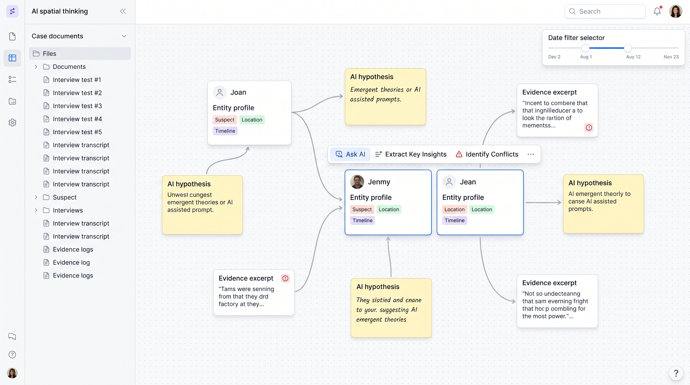

# IntelGraph

**面向中文分析师的时态知识图谱调查工作台。**

IntelGraph 把碎片化、强时效、相互矛盾的材料整理成一张处处有出处的案件图谱：拖动时间轴查看任意时刻的状态，看清信源之间哪里有分歧，追踪跨文档的隐蔽关联，提问时得到带引用的回答。

[中文需求文档](<docs/requirements(cn).md>) · [Requirements (EN)](docs/requirements/README.md)

> `main` 与 `develop` 共用 v1.5.2 需求。`main` 提供需求文档，`develop` 还提供后端环境脚手架。M0 的结论已纳入需求，M1 后端正在并行开发。

从 `develop` 创建开发分支，按任务选择要读的章节。 [开发阅读顺序](docs/requirements/README.md#start-here)

---

## 界面预览

IntelGraph 的界面设计支持在同一个案件里切换三种页面风格。点击下方名称查看各自的设计稿。 [v1 界面规范](docs/requirements/09-ui-ux.md)

时态图谱

文档与证据画布

案件板

## 为什么做

无论是尽调报告、命案卷宗还是剧本杀，分析者面对的是同样的难题：

- **事实会变化，信源会冲突。** 静态图谱分不清“CEO 卸任了”（世界变了）和“爆料与否认”（说法冲突）。
- **关联跨越多份文档。** 向量 Top-k 检索追不住“顾问 → 基金会 → 厂商 → 联盟”这样的多跳链条。
- **AI 回答缺乏出处。** 每个论断都得人工重新核实。

## 核心能力

| | |
| :--- | :--- |
| 🕰️ **事件时间轴** | 每条事实都有生效区间。拖动滑块即可查看任意时刻的图谱，刻度从分钟到年自动适应，也支持小说和剧本杀的故事时间 |
| ⚖️ **考虑信源可靠度的矛盾审阅** | Graphiti 只按日期先后让事实失效。IntelGraph 会记录每次失效的原因，再按信源等级规则修正，并给出建议的胜出方。最终由分析师裁决，所有决定都可撤销 |
| 🔗 **确定性路径发现** | 计算任意时间点、跨文档的最短路径，每一跳都能查看原文摘录，全程不调用大模型 |
| 💬 **有据问答** | 选中实体后用中文提问，可选择思考强度。每条判断必须引用事实；无效引用、已驳斥事实和推演内容都会标出 |
| 📥 **多模态录入** | 支持文档、图片（视觉模型转写后由人工审阅）和分析笔记（可标记为推测） |
| 🧩 **领域模板** | 一套通用本体（人物 · 组织 · 地点 · 物品 · 事件 · 概念），配合商业情报、刑事案件、剧本杀、推理小说四类模板 |

## 工作原理

- **Graphiti** 负责抽取实体和带时间区间的事实。
- **IntelGraph 策略层**修正那些不考虑信源可靠度的失效判定，并把真正的说法分歧交给分析师。
- **前端**把整个案件放在内存中，时间轴拖动和路径计算都在本地即时完成，不请求服务端。

## 技术栈

| 层 | 选型 |
| :--- | :--- |
| 图引擎 | [Graphiti](https://github.com/getzep/graphiti) `0.31.2` + Neo4j ≥ 5.26 |
| 后端 | Python 3.11 · FastAPI · SSE |
| 前端 | React · [@xyflow/react](https://reactflow.dev/) · Zustand |
| 模型 | 任意 OpenAI 兼容端点（默认 DeepSeek，思考强度可选）+ 多语言向量模型（默认阿里百炼 qwen3.7-text-embedding） |

## 路线图

- [x] 需求文档 v1.5.2：已纳入 M0 验证结果和双语 API 契约修正
- [x] 开发环境：Homebrew Neo4j、DeepSeek、阿里百炼向量模型、并行 worktree 支持（`develop` 分支）
- [x] **M0** 技术验证与验收样例冻结。 [集成约定](docs/requirements/07-architecture.md#integration-requirements)
- [ ] **M1** 后端核心：信源录入、Graphiti 适配层、矛盾策略、快照
- [ ] **M2** 前端核心：画布、时间轴、矛盾审阅、路径
- [ ] **M3** 有据问答与验收：英伟达高层变动场景、“雨夜山庄”剧本杀场景

## 文档

英文需求文档按主题拆分，放在 [`docs/requirements/`](docs/requirements/README.md)，附有索引，方便人和编程 agent 按需阅读。完整的中文版见 [`docs/requirements(cn).md`](<docs/requirements(cn).md>)。
