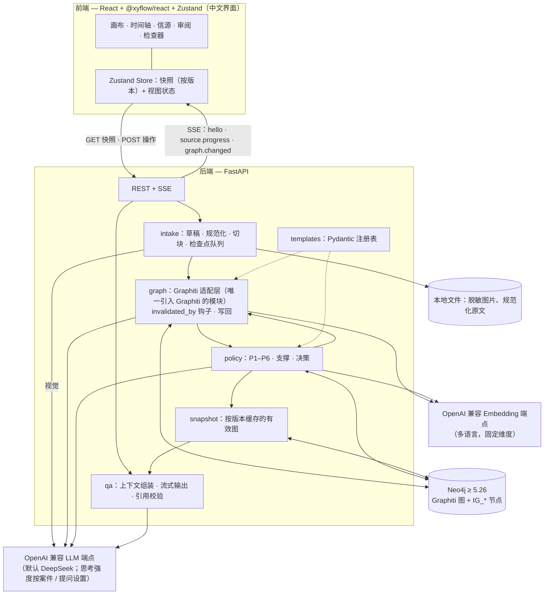

# VeriTrace：时态知识图谱调查工作台

> **版本 1.5.2-PRD** · 待实施草案 · 本文为中文阅读版。英文版按主题拆分在 [`requirements/`](requirements/README.md)，带索引，供 agent 按需读取；涉及标识符时以英文版为准，两份文档须同步更新。

VeriTrace 是一款面向中文分析师的调查工作台，把碎片化、强时效、相互矛盾的材料整理成一张处处有出处的案件图谱。底层基于 **Graphiti**（`graphiti-core==0.31.2`）和 **Neo4j**。

v1 的核心闭环：**录入信源 → 查看任意事件时间的图谱 → 审阅矛盾 → 追踪路径 → 有据提问。**

**开发阅读顺序。** 从 `develop` 开分支，先读下方关键约束，再按任务阅读。

* 后端先读十四（环境）、七（架构）和九（接口）。涉及导入和矛盾策略时，再读 F1 和六。
* 前端先读九（数据契约）、十（界面）和相关功能章节，用手写快照按 `fixture` 模式开发。
* 验收先读十二（场景与测试）和十三（里程碑），按对应的断言检查。

**编号约定：**

* 功能：`F1`–`F6`。
* 策略规则 `P1`–`P6`。P1 在写入过程中捕获，P2–P4 在版本发布前执行，P5–P6 是分析师操作。
* 验收断言：`A1`–`A7`、`B1`–`B3`。
* 里程碑：`M0`–`M3`。

## 关键约束

1. **数据归属。** 实体、边和 Episode 归 Graphiti 所有；VeriTrace 自己的状态存放在 `IG_*` 节点中，以 Graphiti 的 UUID 作为关联键。**唯一的例外：** 策略推翻 Graphiti 的判定，或落实一条陈述终点时，Graphiti 适配层可以把边上的 `invalid_at` / `expired_at` 写回 Graphiti。写回时原值记入决策记录，撤销时还原。除此之外，不写 Graphiti 的任何数据。
2. **v1 只用事件时间。** 事件时间即 Graphiti 的 `valid_at` / `invalid_at`，区间为左闭右开 `[valid_at, invalid_at)`；`reference_time` 是文档日期。认知时间不在 v1 范围内。
3. **Graphiti 只按日期先后让事实失效。** P1–P4 依据信源等级修正这一点。**v1 从不自动裁决**，只给出建议。
4. **串行导入。** 一次只处理一个切块；每个切块有一个两阶段检查点：P1 捕获在 Graphiti 写入之前**暂存**，策略执行完毕后标记为**完成**。该切块的策略执行完毕后才发布新的案件版本；客户端收到 `graph.changed` 后重新拉取快照。
5. **时间轴与路径在前端计算**，基于内存中的快照，拖动时不请求服务端。
6. **每条事实都关联到它的支撑信源**（`IG_FactSupport`）。摘录自动定位并加标注，定位不到时退回整个切块；问答引用一律校验。
7. **语言。** 界面和生成内容用简体中文；代码、字段、枚举、关系类型用英文；实体名保留母语形式并附别名，如 `Jensen Huang（黄仁勋）`。适配层要覆盖 Graphiti 默认的“沿用原文语言”指令。
8. **模型服务。** 一律通过 OpenAI 兼容端点调用（默认 DeepSeek，`json_object` 模式）。
   * **思考强度**（`off` / `low` / `medium` / `high`，即关闭 / 低 / 中 / 高）可以选择：抽取和分类按案件设置，问答按每次提问设置，默认都是关闭。每档对应的请求参数由服务商配置（provider profile）决定。
   * Graphiti 只用一个模型。
   * 向量模型须支持多语言，其原生输出维度必须等于 `EMBEDDING_DIM`。
   * 关闭 Graphiti 遥测。
9. **并行 worktree 共用一个 Neo4j。**
   * 配置统一由 `app/config.py` 解析，密钥取自主 worktree。
   * 每个 Graphiti `group_id` 的格式为 `<namespace>__<case_id>`。
   * 测试只删除自己的 `group_id`；绝不能不带范围地调用 `clear_data()`。

## 术语表

| 术语 | 含义 |
| :--- | :--- |
| 案件（Case） | 一次调查，对应一个 Graphiti `group_id`，带有模板、时区、案件指引和可选的故事锚点 |
| 模板（Template） | 带版本号的配置，按场景定制本体、等级含义和时间模式 |
| 信源（Source） | 一个证据单元：文档、经确认的图片组，或分析师笔记 |
| 图片草稿 | 已上传并转写、等待分析师审阅的图片；确认后成为信源 |
| 切块 / Episode | 信源的一个片段，作为一个 Graphiti `EpisodicNode` 导入，命名为 `{source_id}:{chunk_index}` |
| 实体（Entity） | 类型为 `Person`、`Organization`、`Location`、`Object`、`Event` 或 `Concept` 的节点 |
| 事实（Fact） | 实体之间有方向的关系（Graphiti `EntityEdge`），带中文描述和事件时间区间 |
| 支撑（Support） | 一条 `(事实, 信源, Episode)` 关联（`IG_FactSupport`），携带信源等级和各类标记，是证据展示和印证计算的依据 |
| 最佳等级 | 一条事实所有非推测支撑中最高的等级（T1 最高） |
| 失效 / 写回 | 失效：Graphiti 给事实设置 `invalid_at`。写回：适配层修改 Graphiti 边上的 `invalid_at`/`expired_at`，以落实策略的决定 |
| 陈述终点（stated end） | 信源对某个论断明确说出的结束时间（“X 已于 D 卸任”），由 P1 捕获，由 P3 落实或转入审阅 |
| 主张键（claim key） | 在同一关系内识别同一论断的类型化属性，如 `AFFILIATED_WITH` 的 `role`；由模板定义 |
| 冲突（Conflict） | 一条被记录的矛盾（`disagreement` 或 `contested_change`），带建议和裁决结果 |
| 决策记录 | 只追加的审计记录，每次策略决定和分析师操作都写一条，也是撤销的依据 |
| 版本（Revision） | 案件有效图的单调递增版本号 |
| 思考强度 | `off` \| `low` \| `medium` \| `high`：一次调用允许模型进行多少推理；由服务商配置映射为具体的请求参数 |
| 推测 / 推演 | 推测：来自勾选了“这是推测”的笔记，只有当一条事实的全部支撑都是推测时，这条事实才算推测。推演：来自测试场景中 `synthetic: true` 的信源，无论在哪里出现都标“推演” |

---

## 一、概述

**问题。** 无论是尽调、命案卷宗还是推理情节，分析者都会遇到同样三个问题：

1. **事实会变化，信源会冲突。** 静态图谱要么覆盖历史，要么把矛盾当成并存的事实；它也分不清“世界变了”（CEO 卸任）和“信源说法不一致”（爆料与否认）。
2. **关联跨越多份文档。** 当链条的每一跳来自不同信源时，向量 Top-*k* 检索无法稳定地追踪下去。
3. **AI 回答缺乏出处。** 每个论断都得人工重新核实。

**解法。**

* **基于事件时间的事实。** 被取代的事实转为历史，不删除；时间轴可以展示任意时刻的图谱。
* **考虑可靠度的矛盾审阅。**
  * Graphiti 只按日期先后让事实失效，不看信源。
  * VeriTrace 记录每次失效是由哪条事实引起的，并判断它属于哪类变化。
  * 然后套用分级规则，把修正后的时间区间写回 Graphiti。真正的说法分歧附上建议，交给分析师裁决。
  * 所有策略决定和分析师操作都有记录，均可撤销。
* **结构计算确定，生成有据可查。** 时间轴和路径是纯图计算；每条事实都关联到支撑信源，AI 的判断必须引用事实。

**目标场景**

| 场景 | 典型信源 | 时间尺度 | 关注重点 |
| :--- | :--- | :--- | :--- |
| 商业 / 金融情报 | 申报文件、监管公告、新闻、爆料 | 天至年 | 信源权威性、状态变化 |
| 刑事案件 | 法医报告、监控、通讯记录、证言 | 分钟至天 | 行踪、不在场证明、证言与物证的冲突 |
| 剧本杀 | 规则书 / 主持人确认的事实、线索卡、角色陈述 | 分钟至小时（故事时间） | 谁在说谎 |
| 推理小说 | 章节（叙述 + 对白） | 故事时间 | 不可靠的陈述、隐蔽的关联 |

**语言策略**

| 层面 | 语言 |
| :--- | :--- |
| 界面文案；生成的事实描述、实体摘要、转写描述、AI 回答 | 简体中文 |
| 原文、原语言转写、信源原标题 | 保持原样 |
| 代码、接口、字段名、枚举值、关系类型 | 英文 |
| 实体规范名 | 母语形式或最权威的形式，其他语言写法作为别名；规范名不是中文时，界面显示为 `Jensen Huang（黄仁勋）` |
| 时间 | 以 UTC 存储，按案件时区显示（默认 Asia/Shanghai） |

## 二、范围

### 2.1 v1 功能

| ID | 功能 | 验收要点 |
| :--- | :--- | :--- |
| F1 | 信源录入：文档、图片、笔记、案件指引 | 每种信源都能到达 `committed`，进度持久保存；图片默认先审阅再导入，跳过审阅会留痕；失败的信源可以续传，已提交的切块不重跑 |
| F2 | 图谱画布：锚定布局、过滤、搜索、手动合并 | 新信源进来时，已有节点不移动；合并可撤销 |
| F3 | 事件时间轴 | 拖动时展示 T 时刻的图谱，不请求服务端；刻度在分钟到年之间自适应 |
| F4 | 矛盾审阅 | P1–P4 修正 Graphiti 的失效判定；分析师填写理由后裁决，并可撤销 |
| F5 | 路径发现 | T 时刻的确定性最短路径，每一跳都能打开证据 |
| F6 | 基于选区的有据问答 | 中文流式回答，每条判断都引用事实；无效引用、引用已驳斥事实、含推演的判断都会标出 |

### 2.2 待实现（v1 之后）

| 事项 | 说明 |
| :--- | :--- |
| **认知时间**（“K 日 / 第二轮 / 第五章时我们知道什么”） | Graphiti 的 `created_at`/`expired_at` 记录的是处理时间，也不保留变更历史。实现时需要一份按 `received_at` 或阶段打时间戳的事件日志，并按获取顺序导入。v1 不记录这些数据 |
| 转述限级（T1 叙述中引用的角色原话按 T3 计） | 需要按每条支撑记录发言人。v1 要求把每段陈述作为带发言人的独立信源录入 |
| 校验过的原文区间（核对字符偏移） | v1 的摘录是自动定位的，并加了标注 |
| Tier 1 证据自动裁决 | v1 只给建议 |
| 自研矛盾扫描 | v1 由分析师手动标记（P5）。例外：信源对仍然有效的事实明确说出的结束时间，在 v1 中由 P3 **陈述终点**落实（见六） |
| 自动发现重复实体的队列 | v1 依靠 Graphiti 自身的消歧、已知别名表和手动合并 |
| 可写的 fixture 接口 | v1 的 fixture 模式只读 |
| AI 假设节点；报告导出；人工编辑事实 | |
| Ego 网络、k 条最短路径、服务端寻路 | |
| 扫描版 PDF、Docling | 复用图片管线 |
| 发言人可信度统计 | |
| 刑事、小说模板的验证 | v1 只提供草案配置 |
| 多次运行的统计评测 | |

**探索：** 双轴评级（参照北约 Admiralty 代码）；故事时间中的非线性叙事；用 Graphiti 社区生成全案摘要。

**非目标。** 多人协作与认证（v1 只绑定 `127.0.0.1`）、第十章所列三种风格以外的主题、自动采集、事实数超过约 2,000 条的案件。

## 三、领域模型

### 3.1 核心对象

| 对象 | 含义 | 归属 |
| :--- | :--- | :--- |
| Case | 模板及其版本、时区、带版本的案件指引、可选的故事锚点，以及案件设置（抽取、分类、问答默认值三项思考强度，默认都是 `off`）；对应 `group_id` | VeriTrace |
| Source | 等级、`reference_time`、可选发言人、各类标记 | VeriTrace |
| Chunk | 对规范化文本确定性切分出的片段，带字符偏移和两阶段检查点：**暂存**（P1 捕获在 Graphiti 写入之前持久化）与**完成**（策略已执行完毕，可以发布版本）；见 F1 | VeriTrace |
| Episode | 一个切块对应的 Graphiti `EpisodicNode`，命名为 `{source_id}:{chunk_index}`，其 `valid_at` 等于信源的 `reference_time` | Graphiti |
| Entity | Graphiti `EntityNode` | Graphiti（+ 合并投影） |
| Fact | Graphiti `EntityEdge`：关系名、中文 `fact`、`valid_at`/`invalid_at`、`episodes`、`attributes` | Graphiti |
| Support | `IG_FactSupport`：每当某个 Episode 新建一条事实、或作为重复项再次确认它时，就生成一条，带信源等级、推测/推演标记和自动定位的摘录；信源对该论断明确写出结束时间时，还带 `stated_end`（见六 P1） | VeriTrace |
| Conflict | 类型、建议、状态、裁决历史 | VeriTrace |
| 决策记录 | 失效的保留/写回、陈述终点的落实/转入待确认/确认/驳回、裁决、合并、等级调整、跳过审阅、撤销；存储变更前后的值 | VeriTrace |
| Revision | 每个切块的策略执行完后发布一次，每次分析师修改后也发布一次 | VeriTrace |

### 3.2 归属与写回

* **VeriTrace 的节点**存放在同一个 Neo4j 库中，以 Graphiti 的 UUID 关联：
  * `IG_Case`、`IG_Source`、`IG_Chunk`
  * `IG_ImageDraft`
  * `IG_FactSupport`
  * `IG_Conflict`
  * `IG_Merge`
  * `IG_Layout`
  * `IG_Decision`
* **唯一的写回。** P3 或 P6 推翻 Graphiti 的失效判定，或落实一条陈述终点时，由适配层把 `invalid_at`/`expired_at` 写回 Graphiti 的边；原值存入决策记录，撤销时还原。
* **为什么要写回。** Graphiti 后续的矛盾判断从数据库读取这两个字段，它看不到覆盖层；写回后，它的判断才能与分析师看到的状态一致。
* **其余字段只读。** Graphiti 的其他属性对 VeriTrace 一律只读。
* **快照构建器**把 Graphiti 数据与合并、支撑、冲突、标记组合成某个版本的有效图，并缓存起来，供快照接口和问答共用。

### 3.3 本体

**核心实体类型**在各场景通用，在警务标准 POLE 模型（人物、物品、地点、事件）的基础上扩展而来：

| 类型 | 涵盖 | 金融 | 刑事 | 剧本杀 / 小说 |
| :--- | :--- | :--- | :--- | :--- |
| `Person` | 个人、角色 | 高管、官员 | 嫌疑人、受害者、证人 | 角色 |
| `Organization` | 公司、机构、团体 | 公司、监管机构 | 团伙、雇主 | 家族、派系 |
| `Location` | 场所、房间、地址 | 总部、司法辖区 | 现场、住址 | 山庄的房间 |
| `Object` | 实物或文书、账户、资产、产品 | 芯片、申报文件、账户 | 凶器、手机、车辆 | 线索道具、信件 |
| `Event` | 行为、会面、交易、事故 | 调查、申报、人事交接 | 案件本身、通话、转账 | 命案、争吵 |
| `Concept` | 抽象主题 | 政策、技术（CUDA） | 动机、债务 | 秘密、遗嘱、规则 |

Graphiti 返回的实体如果没有核心类型标签，就按 `Concept` 显示，并加“未分类”角标。一个节点带多个标签时，按上表顺序取第一个核心类型。

**核心关系类型**以 `edge_types` + `edge_type_map` 的形式传给 Graphiti：

| 关系 | 类型化属性 | 含义 |
| :--- | :--- | :--- |
| `AFFILIATED_WITH` | `role` | 任职、隶属 |
| `SOCIAL_TIE` | `kind` | 亲属、恋人、朋友、仇人、生意伙伴 |
| `LOCATED_AT` | — | 人或物在某个地点；事件时间区间即行踪与不在场证明 |
| `PARTICIPATED_IN` | `role` | 发起者、受害者、目击者、当事方 |
| `OCCURRED_AT` | — | 事件发生的地点 |
| `OWNS` | — | 拥有、持有 |
| `TRANSFERRED` | `item`、`amount` | 资金或物品的流向 |
| `COMMUNICATED_WITH` | `channel` | 双方之间的联系 |
| `CAUSED` | — | 事件之间的因果 |
| `INVESTIGATES` | — | 对某一方的调查 |
| `RELATED_TO` | — | 兜底；Graphiti 产生的、没有自定义类型的关系也归入此类 |

**所有关系的共有属性**来自一个公共 Pydantic 基类：

* `modality`：`stated` | `planned` | `denied` | `suspected`。缺失时在适配层统一补为 `stated`。
* `asserted_by`：转述内容的发言人。

Graphiti 的每条边只有一份属性表，由所有重复支撑共用，所以 v1 中 `asserted_by` 只作展示，不影响等级。快照通过 `Fact.attributes` 输出这些类型化属性。

### 3.4 案件模板

* 模板是经 Pydantic 校验的配置，统一放在注册表中；每个案件固定使用某个模板**及其版本**。
* 模板复用共享的实体与边模型，不含任何代码。
* 模板定义：
  * 子类型标签；
  * 额外的关系类型，以及 `edge_type_map`；
  * 每种关系的**主张键**：识别同一论断的类型化属性，如 `AFFILIATED_WITH` 的 `role`、`SOCIAL_TIE` 的 `kind`；供 P3 陈述终点使用（见六）；
  * 抽取指令，随每个 Episode 作为 Graphiti 的 `custom_extraction_instructions` 传入：
    * 中文的事实描述与摘要；
    * 命名规则（现实中的同一指称对象只建一个实体；规范名取母语形式或最权威的形式，其他语言的写法作为别名），后接案件的已知别名表；
    * 原子化事实（一条事实只表达一个论断）；
    * 用 `modality` 表达计划和否认；
    * 案件的 UTC 偏移，使抽取出的时间为案件本地时间（见五）；
  * 等级标签，以及每种信源类型的默认等级；
  * 时间模式（`absolute` | `story`）和默认刻度。

| 模板 | 额外关系 | 时间 | v1 状态 |
| :--- | :--- | :--- | :--- |
| `corporate_intel` | `FUNDS`、`REGULATES`、`ANNOUNCES` | 绝对时间，按天 | v1 中验证（场景 A） |
| `murder_mystery_game` | `SUSPECTS`、`HAS_MOTIVE`、`USED` | 故事时间，按分钟 | v1 中验证（场景 B） |
| `criminal_case` | `HAS_MOTIVE`、`USED` | 绝对时间，按分钟 | 草案配置 |
| `mystery_fiction` | `SUSPECTS`、`HAS_MOTIVE` | 故事时间，按分钟 | 草案配置 |

### 3.5 合并（规范投影）

* **映射关系。** 合并记录为 `IG_Merge { alias_id → canonical_id }`，只能在同一案件内的同类型实体之间进行。
  * 映射会解析到根节点：合并到一个别名上，等于合并到它的规范节点。
  * 会形成环的合并会被拒绝。
* **快照构建器的处理：**
  * 把事实端点重映射为规范 ID；
  * 合并两边的别名和支撑；
  * `first_seen` 取各成员中最早的；
  * 原有事实全部保留为平行事实，互不合并；
  * 重映射后变成自环的事实只在检查器中显示。
* **保留原始数据。** 原始 UUID 和别名节点的布局坐标都保留，因此撤销是精确的。
* **撤销规则。** 只有当后续没有依赖它的合并时，才能撤销；否则须先撤销那些依赖它的合并。
* **后续入库。** Graphiti 之后仍按原始节点做消歧：
  * 新边无论连到哪个原始节点，都会被自动重映射；
  * 如果为已知别名又新建了一个原始节点，需要再合并一次；
  * 为减少这种情况，案件的已知别名表会写入抽取指令。

## 四、信源与可靠度分级

### 4.1 信源类型

| 类型 | 输入 | 处理 |
| :--- | :--- | :--- |
| `document` | 粘贴文本、`.txt`、`.md`、带文本层的 `.pdf` | 规范化、切块、导入 |
| `image` | 1–10 张图片，经图片草稿流程 | 导入审阅后的文本 |
| `note` | 分析师撰写的内容 | 按文档导入；勾选“这是推测，不是证据”即设置 `speculative` |

每个信源都有：

* `reference_time`：文档日期；故事模式下按故事日历填写。
* `source_type`：取自模板中的列表，决定默认等级。
* 可选的 `speaker`（发言人）。
* `speculative` 和 `synthetic` 标记。

### 4.2 图片草稿

1. **选择。** 浏览器读取 EXIF 拍摄时间。它只作为 `reference_time` 的建议值，因为常常缺少时区，也可能与文档日期不同。
2. **脱敏。** 浏览器为每张图生成一份脱敏副本：去除 EXIF（含 GPS），长边 ≤ 2048 px，WebP/JPEG 质量约 0.8，单张 ≤ 1.5 MB，单个草稿合计 ≤ 10 MB。**原图字节永远不离开浏览器。** 作为证据存储、以及发给视觉模型的，都是这份脱敏副本。
3. **上传。** 上传时创建 `IG_ImageDraft`，服务端校验 MIME 类型；未确认的草稿 24 小时后过期。
4. **转写。** 每个草稿只发一次视觉请求，每张图得到三项：
   * `original_text`：原语言逐字文本；
   * `description_zh`：中文的画面描述；
   * `detected_dates`：图中识别到的日历日期，可附带时间；单独的钟点（如“21:00”）不算日期。

   只重试失败的那几张。只要有任何一张图片无效，服务商就会拒绝整个请求，因此每张图片先校验再发送；请求仍因某张图片失败时，把那张标记为失败，其余的不带它重发（见 7.3）。
5. **审阅。** 分析师编辑 `reviewed_text`。人工修改与模型输出分开保存；修改后不会重新识别。
6. **确认。** 确认后创建信源，导入的是 `reviewed_text`。可以跳过审阅，但会写入决策记录。

证据视图中，图片与转写并排显示，转写标注为*机器转写*；经过修改的标注为*人工修订*。

### 4.3 案件指引

案件指引是一段分析指引，例如“重点关注资金流向”“‘老王’指王建国”。它**不是**信源：

* 有版本记录；每个导入任务固定使用启动时的版本。
* 附加到抽取指令和问答的系统提示中，并明确标注为“指引，不是证据”。
* 不导入图谱，也不会被引用。

### 4.4 三个等级，含义随模板而定

**T1 最高。** 每种信源类型的默认等级由模板定义。分析师随时可以调整，每次调整都写入决策记录，并可撤销。

| 等级 | `corporate_intel` | `criminal_case` | `murder_mystery_game` | `mystery_fiction` |
| :--- | :--- | :--- | :--- | :--- |
| T1 | 证据效力强的官方记录（申报文件、监管公告、法院文书） | 法医与客观记录（尸检、DNA、监控、通讯记录） | 规则书 / 主持人确认的事实 | 全知叙述 |
| T2 | 有署名的报道；不具约束力的官方声明 | 书证；中立证人 | 线索卡（物证） | 文中描写的物证、书证 |
| T3 | 匿名帖、爆料、传闻 | 涉案人陈述；传闻 | 角色陈述（可能说谎） | 人物对白与证词 |

**规则：**

* **支撑的等级。** 每条支撑携带其信源的等级。
* **最佳等级。** 事实的最佳等级，取它所有非推测支撑中最高的等级；如果全部支撑都是推测，就没有最佳等级，按推测显示。
* **v1 的发言人归属。** 以信源为单位；剧本杀和小说中，每段陈述作为带 `speaker` 的独立信源录入。
* **不同信源。** 印证按不同的信源 ID 计数。规范化后内容完全相同的会被当作重复拒绝；措辞不同的转载各自计数，是否属于同一来源，在 v1 中由分析师自行判断。

**局限：** 不可靠的叙述者、伪造的线索仍可能误导判断，分析师可以调整信源等级；利益相关方的陈述在 v1 中不单独建模。

## 五、时间模型与事实状态

### 5.1 v1 只用事件时间

| 概念 | Graphiti 字段 | v1 的处理 |
| :--- | :--- | :--- |
| 文档时间 | `EpisodicNode.valid_at`，来自 `add_episode(reference_time=…)` | 即信源的 `reference_time` |
| 事件时间起点 | `EntityEdge.valid_at`，由 LLM 以 `reference_time` 为参照抽取 | 为空时，显示上回落到各支撑中最早的 `reference_time`，并标记 `valid_at_inferred`（界面显示“≈”）。Graphiti 的日期判断会跳过起点为空的事实，所以这类事实不会被自动失效，分析师可以用 P5 处理 |
| 事件时间终点 | `EntityEdge.invalid_at`，来自原文明确写出的结束时间，或 Graphiti 的失效判定 | 失效判定由 P1–P4 处理；策略推翻时写回修正值。信源对仍然有效的事实明确说出的结束时间，由 P3 **陈述终点**落实（见六） |
| 系统时间戳 | `created_at`；`expired_at`（处理时的时钟） | 不显示；写回时 `expired_at` 与 `invalid_at` 一起修改 |

### 5.2 Graphiti 如何检测矛盾

Graphiti 的检测是有上限、尽力而为的，不能当作完整检测：

* **检索有上限。** 对每条新事实，Graphiti 在案件范围内检索排名靠前的有限个候选，再由 LLM 判断其中哪些构成矛盾。
* **不看信源。** 确认矛盾后，`valid_at` **严格更早**的一方被失效，结束时间设为对方的 `valid_at`，与信源无关。
* **以下情况不会失效：**
  * 两条事实的起点相同或为空；
  * 两条事实的时间区间不重叠；
  * 候选事实的结束时间已经不晚于新事实的起点。
* **起点决定是否触发失效。** 信源复述一条已有事实并附上结束时间（“X 已于 D 卸任 CEO”）时，抽取结果可能沿用原起点并附上结束时间。Graphiti 不会让同起点的事实失效，消歧合并时也会丢掉新来的结束时间。P1 捕获这类陈述终点，P3 按匹配条件和信源等级处理（见六）。
* **补录旧文档。** 较早的文档后导入时，可能让*它自己*的新事实失效，因为库里已有一条起点更晚的事实。
* **对顺序敏感。** 结果会随导入顺序和近期 Episode 上下文而变化，不保证每次得到相同的图。

由此得出两点：

* 漏检的矛盾由 P5（分析师手动标记）补上。
* 写回确保 Graphiti 始终基于修正后的区间做判断。如果不写回、留着被推翻的失效，之后真正发生的状态变化会被它跳过。

### 5.3 区间与日历规则

* **区间为左闭右开** `[valid_at, invalid_at)`；`invalid_at` 为空表示仍然有效。
* **精度。** 时间精确到分钟存储；只到“天”的日期，按案件时区的 00:00 计，由适配层保证。抽取指令写明案件的 UTC 偏移，只到日期的值在 Graphiti 判定该事实之前先归一化到案件本地午夜；不归一化的话，`2026-12-15` 这样的日期会被读成 00:00 UTC，在上海就是 08:00（M0 中出现过）。
* **故事时间。** 案件设定一个锚点日期，故事第 n 天 = 锚点 + (n−1) 天、案件本地时间 00:00。故事案件使用固定偏移时区（默认 UTC+8，不考虑夏令时）。界面显示为“第n天 HH:mm”。
* **时间轴刻度。** 初始缩放和滑块步长取自模板；刻度标签随可见范围自适应。

### 5.4 T 时刻的时间状态

**起点：** 事实的*起点*即 `display_valid_at_ts`：有 `valid_at` 时取 `valid_at`，为空时取各支撑中最早的 `reference_time`，并标记 `valid_at_inferred`。起点永远不为空；时间轴（F3）、路径（F5）、问答（F6）都使用它。

推导得出，不存储：

| 状态 | 条件 |
| :--- | :--- |
| `future` 未发生 | 起点 `> T` |
| `expired` 已失效 | `invalid_at ≠ null ∧ invalid_at ≤ T` |
| `active` 有效 | 其他情况 |

节点在 `first_seen ≤ T` 时显示。`first_seen` 取其所有事实中最早的起点；没有任何事实的孤立实体，取提及它的信源中最早的 `reference_time`。

### 5.5 可信状态与标记

`status` 只取一个值，按下表顺序推导，命中第一条即停：

| 状态 | 规则 |
| :--- | :--- |
| `refuted` 已驳斥 | 在某次未被撤销的裁决中落败；即使同时还属于其他冲突，也是这个状态 |
| `disputed` 有争议 | 至少属于一个未解决的冲突 |
| `corroborated` 已印证 | 有一条非推测的 T1 支撑，**或** 有 ≥ 2 个不同的、等级 ≤ T2 的非推测信源支撑。界面上的“已印证”严格指这条规则 |
| `reported` 已报告 | 其他情况 |

此外有三个相互独立的标记：

| 标记 | 规则 |
| :--- | :--- |
| `speculative` 推测 | 全部支撑都是推测 |
| `synthetic` 推演 | 至少一条支撑来自推演信源；这条事实在任何地方出现都标“推演” |
| `closure_unconfirmed` 失效待确认 | Graphiti 让它失效了，但 P1 无法确定原因，或 P2 无法分类 |
| `end_claimed` 结束待确认 | 有信源对这条仍然有效的事实明确说出了结束时间，但 P3 没有落实：信源可靠度更低，或匹配不唯一（见六） |

## 六、矛盾处理策略（v1）

**为什么需要。** Graphiti 确认矛盾后，总是让 `valid_at` 更早的一方失效，不看信源。于是：

* 一条日期更晚的 T3 爆料，会让 T1 事实失效；
* 一条日期更晚的否认声明，会让爆料失效。

**执行时机：**

* P1–P4 在每个切块的 `add_episode` 之后、发布版本之前，按顺序自动执行。
* 任何一方的最佳等级发生变化时（调整等级、导入中新增支撑、推测标记变化），执行 **P3 复核**并重新计算 P4；合并之后也会重新计算 P4。
* **P3 陈述终点**在 P3 处理完失效判定之后、同一切块内执行。
* P5–P6 是分析师操作。
* 每条规则的结果都写入决策记录。

**P1 · 记录失效及其原因。**

在单次 `add_episode` 调用期间，适配层包装 `graphiti_core.graphiti.resolve_extracted_edges`，把它自带的 `invalidated_by` 参数传进去。这个参数在 0.31.2 中已经存在，只是 `add_episode` 没有传。这样就能拿到精确的配对：*被失效的事实 → 导致它失效的新事实*。

**自身失效（补录旧文档）**是另一种情况：Graphiti 因为库里已有一条起点更晚的候选，而让新进来的事实失效。适配层在同一次 resolver 调用内部观察 Graphiti 的时间处理步骤（`_apply_temporal_invalidation`），因为只有在那里才能看到 LLM 选出的候选。

* 如果这份候选列表中恰好只有一条互不相同的已存候选，其 `valid_at` 等于新事实的新 `invalid_at`，就认定它是原因。
* 否则记为**无法归因**。
* 新事实在时间处理步骤之前就已带有的结束时间来自原文；那是下面说的陈述终点，不是自身失效。

**陈述终点。** 在同一次 resolver 调用中，适配层还记录每条原文明确说出结束时间的新事实：抽取在 Graphiti 的时间处理步骤之前就给它设了 `invalid_at`，且其 `modality` 为 `stated`。Graphiti 不会把这样的结束时间应用到已有事实：新事实作为重复项时，保留已存的边、丢掉新来的结束时间；作为同起点的平行事实时，什么也不失效（见五）。对每条陈述终点，适配层记录：

* 结束时间；
* 主张：规范化端点、关系和主张键属性；
* 消歧结果：被合并进已有事实，还是存为独立的事实。

结束时间保留在最终生成的支撑上，即 `stated_end`（见三），由 P3 落实。

**持久化。** 仅凭已提交的 Episode 无法还原因果映射和边的原时间。适配层记录被失效事实在本切块之前的 `invalid_at`/`expired_at`，供写回和撤销使用。自身失效的事实记录时间处理步骤之前的值。适配层在 Graphiti 写入前把这些值、因果映射和陈述终点存入该切块的**暂存**检查点（见 F1）。升级 Graphiti 时须运行契约测试验证钩子。

**P2 · 对已归因的配对分类。**

每批调用一次小模型，打上以下标签之一。调用使用 temperature 0、带版本号的提示词，以及案件设置中的分类思考强度（默认 `off`）。

| 标签 | 含义 |
| :--- | :--- |
| `CHANGE` | 世界状态变了，旧事实确实结束了 |
| `DISAGREE` | 不同信源对同一时期的说法相互矛盾 |
| `COMPATIBLE` | 其实并不矛盾，是 Graphiti 判错了，比如“计划离职”与“目前在任” |

分类失败重试一次；仍然失败，就按无法归因处理。分类失败不会阻塞导入。

**P3 · 执行。**

下表中，“胜方”指导致失效的事实，“败方”指被失效的事实；等级均指最佳等级。

| 情况 | 结果 |
| :--- | :--- |
| `CHANGE`，且胜方等级不低于败方 | 保留 Graphiti 的失效判定 |
| `CHANGE`，但胜方可靠度更低 | 把败方本切块之前的值**写回**；开一个 `contested_change` 冲突 |
| `DISAGREE` | 写回败方之前的值；开一个 `disagreement` 冲突；双方都变为 `disputed` |
| `COMPATIBLE` | 写回败方之前的值；不开冲突 |
| 无法归因或无法分类 | 保留 Graphiti 的失效判定，设置 `closure_unconfirmed`；分析师可在审阅列表中选择*撤销失效*（写回）或*确认失效* |

写回由适配层在切块之间、串行状态下执行，变更前后的值都会记录。

**P3 · 陈述终点。**

把 P1 捕获的陈述终点落实到仍然有效的事实上。推测支撑，以及 `modality` 不为 `stated` 的陈述终点，一律忽略。

**目标**是同时满足以下条件的唯一一条开放事实（`invalid_at` 为空）：

* 规范化端点（合并之后）和关系都与陈述终点相同；
* 主张键属性与陈述终点的相等；
* 起点早于陈述终点。

每种关系的主张键由模板定义，例如 `AFFILIATED_WITH` 的 `role`、`SOCIAL_TIE` 的 `kind`。没有定义主张键的关系，只按端点和关系匹配。

| 情况 | 结果 |
| :--- | :--- |
| 恰好一个目标，且陈述终点的支撑等级不低于目标事实的最佳等级 | 把陈述终点**写回**到目标事实：`invalid_at` = 陈述终点，`expired_at` = 当前时间。结果自动保留，因此受 P3 复核约束 |
| 恰好一个目标，但该支撑可靠度更低 | 不写回；给目标事实设置 `end_claimed`。分析师可在审阅列表中选择*确认结束*（写入该结束时间）或*驳回*（见 F4） |
| 候选不止一个，例如一句捆绑陈述覆盖多个职位 | 不写回；给每条候选事实都设置 `end_claimed`，由分析师按上面的方式处理 |
| 没有候选 | 无可落实；存为独立事实的陈述终点就保持为那条事实 |

**P3 复核。** 适用于 P3 按 `CHANGE` 第一行**自动保留**的失效判定，以及 P3 自动落实的每条陈述终点；任何一方的最佳等级发生变化时，都要重新检查。

* **条件不再成立时：** 如果“胜方等级不低于败方”已经不成立，就按 `CHANGE` 胜方可靠度更低的那一行处理：写回败方失效前的值，并开一个 `contested_change` 冲突。
  * 对陈述终点，条件是支撑等级不低于目标事实的最佳等级；不再成立时，写回目标事实失效前的值，并设置 `end_claimed`。
  * 例如胜方的信源被降级；
  * 又如败方获得了更高等级的支撑，比如 Graphiti 把一个新的 T1 信源识别为重复事实并合并到败方。
  * 复核会写入决策记录；撤销触发它的那次等级调整时，复核的处理也一并撤销。
* **只在一个方向上自动处理：** 等级变化只会*开启*审阅，从不自动让事实失效，也从不自动解决冲突。`contested_change` 冲突的胜方等级后来提高到不低于对方时，只更新 P4 的建议；已设置 `end_claimed` 的支撑后来提高到不低于对方时，仍留在审阅中。
* **不在复核范围内：** 分析师通过 P6 接受的变化（`change_accepted`）、分析师已确认或已驳回的陈述终点，以及已裁决的冲突。

**P4 · 建议胜出方。**

* 比较双方的最佳等级：只有一方更高时，它就是**建议胜出方**（普通强度）；等级相同则不给建议。
* 如果建议方有一条非推测的 T1 支撑，而且该信源的 `reference_time` 不早于对方各支撑中最晚的 `reference_time`，建议就升级为**强**。
* **v1 从不自动裁决。**

**P5 · 手动冲突。** 分析师选中两条事实，标记为冲突。系统开一个 `disagreement` 冲突，双方都变为 `disputed`；不改动 Graphiti 的数据。

**P6 · 裁决。**

必须填写理由；每次操作都写入决策记录。

| 冲突类型 | 结果 | 冲突状态 | 影响 |
| :--- | :--- | :--- | :--- |
| `disagreement` | `a`（A 成立）/ `b`（B 成立） | 已解决 | 败方变为 `refuted` |
| `disagreement` | `both_partial`（都部分成立） | 已解决 | 不驳斥任何一方 |
| `disagreement` | `not_conflict`（不构成冲突） | 已解决 | 不驳斥任何一方 |
| `contested_change` | `change_accepted`（变化成立） | 已解决 | 写回 Graphiti 原本的失效判定：旧事实在新事实的 `valid_at` 结束；不驳斥任何一方（旧事实在变化之前是成立的） |
| `contested_change` | `change_rejected`（变化不成立） | 已解决 | 新事实变为 `refuted` |
| 任意 | 保持待定 | 仍为未解决 | 记录理由 |

**撤销**（`POST /decisions/{id}/undo`）：

* 追加一条反向决策；
* 恢复之前的状态，包括写回过的值；
* 只能撤销某个对象上最近一次未被撤销的决策；
* 撤销后可以重新裁决。

**相互影响：**

* 调整等级会重新计算印证状态和建议，并触发 P3 复核；但不会推翻分析师的任何决定，包括 P6 裁决和分析师接受的变化（`change_accepted`）。
* 已驳斥优先于未解决的冲突。

## 七、系统架构



### 7.1 模块边界

| 模块 | 职责 | 不得 |
| :--- | :--- | :--- |
| `graph` | 唯一引入 `graphiti_core` 的模块：构建客户端、调用 `add_episode`、`invalidated_by` 钩子、写回、读取原始图数据 | 包含策略逻辑 |
| `intake` | 草稿、规范化、切块、检查点、按案件排队的 FIFO 工作进程 | 直接调用 Graphiti |
| `policy` | P1–P6、支撑与摘录定位、决策、撤销 | 引入 Graphiti 的类型 |
| `snapshot` | 构建并缓存各版本的有效图，发布 `graph.changed` | 写数据 |
| `qa` | 基于缓存快照组装上下文、流式输出、校验引用 | 调用 Graphiti 的检索 |
| `templates` | Pydantic 模板定义与注册表 | 包含可执行逻辑 |
| `overlay` | `IG_*` 节点的仓储：Cypher 读写、事务、案件范围、稳定键 | 包含业务逻辑 |
| `contracts` | 共享的 Pydantic 模型：API 结构（八）、SSE 载荷、错误、`graph` 与 `policy` 之间的捕获 DTO | 包含逻辑；引入 `graphiti_core` |
| `api` | FastAPI 路由；OpenAPI 定义的来源 | 包含业务逻辑 |

前端类型由后端的 OpenAPI 定义生成；SSE 事件内容共用同一个 schema 模块。

### 7.2 关键决策

| 决策 | 理由 |
| :--- | :--- |
| 单一存储 Neo4j ≥ 5.26，**不需要 APOC** | Graphiti 不支持 Postgres；固定版本的代码路径中没有任何 APOC 调用 |
| 使用 Graphiti 默认的向量检索（对存储的向量计算余弦相似度），不额外建向量索引 | 0.31.2 本身就是这样实现的；每个库的向量模型和维度固定，更换须重新生成向量 |
| 在 `graph` 适配层之后固定 `graphiti-core==0.31.2` | `invalidated_by` 钩子和写回都依赖其内部实现；用契约测试守住升级 |
| 一个导入工作进程，一次处理一个切块 | Graphiti 要求同一个图上的 `add_episode` 依次调用；串行也让 P1 记录和写回没有竞争 |
| 每个切块的策略执行完、每次分析师修改后，各发布一个版本 | 客户端永远不会看到未经策略处理的原始数据 |
| 用 `graph.changed {version}` + 重新拉取快照，代替逐条增量 | 本地快照 ≤ 1 MB；省掉增量合并、删除标记和断线重放；类型化增量留作日后经测量再做的优化 |
| 快照按版本缓存，问答读同一份缓存 | 不重复读图；问答上下文与分析师看到的内容一致 |
| 时间轴和路径在前端计算 | 整个案件放得进内存，两者使用同一套时间语义 |
| 视觉处理放在 Graphiti 之前 | Graphiti 的导入接口只接受文本 |

### 7.3 集成约定

* **Graphiti 的 LLM。** 配置为 `OpenAIGenericClient(config=LLMConfig(api_key=…, base_url=…, model=…), structured_output_mode="json_object")`。
  * **必须用 `json_object`**：DeepSeek 的 Chat Completions 只支持 `text` 和 `json_object`，没有 `json_schema`。
  * **Graphiti 只用一个模型**：这个客户端不会把请求分流给 `small_model`。
  * VeriTrace 自己的调用走 OpenAI SDK，其中 P2 分类可以使用 `LLM_SMALL_MODEL`。
  * **类型化属性必须归一化。** `json_object` 模式下，Graphiti 会把原始 JSON Schema 直接贴进提示词；DeepSeek 随后常把属性值再包一层 `properties`（或 `attributes`，或类型名）。Graphiti 会保留未声明的键，于是这层嵌套映射进了 Neo4j，整个 Episode 随之回滚。
    * 适配层重写 `generate_response`，对属性抽取调用解开这样的一层嵌套。
    * 只保留通过严格校验的已声明字段。
    * 每次解嵌套和每个被丢弃的键都写日志。
  * **“完成”以提交为准。** 抽取成功是指 Episode 已提交，而不只是收到一段可解析的 JSON。
* **思考强度。** DeepSeek 默认开启思考（强度为 `high`），所以每次调用都必须明确指定档位。
  * 后端的**服务商配置**（`LLM_PROVIDER_PROFILE`）负责把档位映射为请求参数。DeepSeek 的对应关系如下，环境调试时均已验证可用：

    | 档位 | 请求参数 |
    | :--- | :--- |
    | `off` | `extra_body={"thinking": {"type": "disabled"}}` |
    | `low` / `medium` / `high` | `extra_body={"reasoning_effort": <档位>}` |

  * 如果服务商配置声明不支持思考，界面就隐藏所有思考强度选择器。
  * Graphiti 的 `OpenAIGenericClient` 不会发送这两个参数；适配层通过子类化它，按当前任务的抽取强度注入 `extra_body`。
  * 思考模式下服务商会忽略 `temperature`，结果波动更大。
  * 每档都要校验 `json_object` 输出。M0 的四档均产出过合法 JSON，其中一次独立试验的 `medium` 抽取在解析失败后重试成功。
  * 视觉转写一律使用 `off`。
* **输出语言。** Graphiti 会追加“沿用原文语言”的指令：模块级的 `get_extraction_language_instruction`，由 `openai_generic_client.py` 调用。适配层在请求时通过按实例的 SDK 钩子替换这个后缀，使事实描述和摘要输出中文，实体名保留母语形式。
  * 后缀不再匹配时钩子会抛错，Graphiti 升级会因此立刻暴露。
* **命名与时间指令。** 每次 `add_episode` 都把模板的抽取指令作为 `custom_extraction_instructions` 传入（见三）：
  * 命名规则，附案件的已知别名表；
  * 案件的 UTC 偏移。

  M0 中，没有已知别名表时，黄仁勋和 Jensen Huang 成了两个节点；加上之后不再出现重复，别名也得到了保留。
* **时间归一化。** 只到日期的值在 Graphiti 判定该事实之前先归一化到案件本地午夜（见五）。契约测试用一个只含日期的英文时间和一个中文本地钟点各检查一次。
* **捕获钩子的位置。**
  * 适配层在一次串行的 `add_episode` 外围打包（patch）`graphiti_core.graphiti.resolve_extracted_edges`。
  * 在该调用内部观察 `_apply_temporal_invalidation`（用于自身失效）和逐边消歧（用于陈述终点）。
  * 在 Graphiti 写入之前持久化暂存检查点。
  * 写回是一条带范围的 Cypher 语句，只修改 `RELATES_TO {uuid, group_id}` 上的 `invalid_at` 和 `expired_at`，并返回修改前后的值。
* **向量模型。** 用 `OpenAIEmbedder` 接多语言端点，默认是阿里百炼 `qwen3.7-text-embedding`（1024 维）。
  * 要用 OpenAI 兼容路径 `/compatible-mode/v1`，不要用 DashScope 原生的 `/api/v1`。
  * Graphiti 不会发送 `dimensions` 参数，而是把向量截断成 `EMBEDDING_DIM` 维，所以模型的**原生**输出维度必须等于 `EMBEDDING_DIM`。
  * 模型和维度都要固定。
* **重排序。** 注入一个保持原有顺序的 `CrossEncoderClient` 桩实现，这样就不需要 OpenAI 密钥。VeriTrace 不使用 Graphiti 的检索打分。`Graphiti.search()` 从不调用这个桩，所以冒烟测试用带重排序配方的 `search_()`。
* **摘录定位。** 每个切块处理完后，`policy` 把切块中的句子各生成一次向量；每条新支撑取与事实描述最接近的那句作为摘录（`located: "auto"`）。没有句子超过阈值时，退回整个切块（`located: "none"`）。这一步不调用 LLM。
* **全文检索。** 沿用 Graphiti 的默认分析器。两套 M0 试验都未发现 `cjk` 提升召回，其中 30 条中文查询的 recall@10 和 MRR 与默认分析器相同。用 `IF NOT EXISTS` 创建具名索引，保留已有的共享索引。
* **遥测。** Graphiti 默认开启遥测。必须在引入 Graphiti 之前设置 `GRAPHITI_TELEMETRY_ENABLED=false`。验收检查要在普通进程中执行：Graphiti 在 pytest 下会强制关闭遥测，可能掩盖漏配。
* **案件隔离。** 适配层的每次调用都必须显式传入 `group_id`，没有就拒绝执行。每个接口资源都要核对它所属的案件。
  * Graphiti 对省略范围的行为因操作而异：`add_episode` 写入默认分组 `''`；`search` 读取**所有**分组，传 `[]` 和 `[""]` 也一样。
  * 全文过滤先按分词短语匹配 `group_id`，再用 Cypher 精确过滤。一个 group ID 的词是另一个的延伸（`…-x` 与 `…-x-2`）时不会串数据，但可能挤占对方的候选数量上限。
  * 因此案件 ID 使用定长词元，如 `uuid4().hex`。适配层自有的查询一律在精确分组过滤之后再套用结果上限。
* **视觉。** 通过 OpenAI SDK 直接调用，每个草稿只发一次请求：`image_url` 以 base64 传入，`json_object`，temperature 0，思考强度 `off`。M0 用 `LLM_MODEL` 转写 3/3 张图片均为逐字准确。
  * 只要有任何一张图片无效，服务商就会以指明 `content[i]` 的 400 拒绝**整个**请求，因此每张脱敏图片先校验再发送；遇到这种 400 时，把指名的那张标记为失败，其余的不带它重发（见 4.2）。

### 7.4 运行模式

| 模式 | 行为 | 用途 |
| :--- | :--- | :--- |
| `live` | 完整管线 | 实际使用 |
| `fixture` | **只读**：从 `fixtures/` 提供冻结的快照和证据，外加脚本化的 `source.progress` / `graph.changed` 事件序列和录制好的问答流。修改类接口返回 `501`，界面上也禁用；不需要 Neo4j 和 LLM | 前端开发、读路径的端到端测试、稳定演示 |

## 八、v1 功能需求

### F1 信源录入

* **新建案件：** 名称、模板及版本、时区；故事模式下还要设锚点。
* **案件指引：** 随时可通过 `PUT /cases/{id}/brief` 修改，每个版本都保留；修改只对之后启动的任务生效。
* **添加文档或笔记：**
  * 字段：标题、`source_type`（决定默认等级）、等级（可修改）、`reference_time`（必填），以及可选的发言人、URL 和备注；笔记另有推测勾选项。
  * 客户端发送 `Idempotency-Key`；相同的 key 重复提交时，返回同一个信源。
  * 如果案件中已有规范化后完全相同的内容，返回 `409 duplicate_source`，并附上已有信源的 ID。
* **添加图片：** 走图片草稿流程（4.2）：
  1. 上传脱敏副本；
  2. 转写；
  3. 审阅；
  4. 确认，生成信源。

  草稿卡片依次显示 `uploading → transcribing → awaiting_review`（或 `failed`），刷新页面后仍在。
* **规范化与切块：**
  * 规范化：NFC 编码、统一换行、去除首尾空白。
  * 单个信源最多 200,000 字符。
  * 按段落边界切成约 1,500 token 的块；过长的段落在句子边界处再切。
  * 每个块记录它在规范化文本中的字符偏移。
* **导入任务：** 启动时固定模板版本、指引版本，以及抽取和分类的思考强度（每个切块都会记录这些值），然后一次处理一个切块：
  1. `add_episode(name="{source_id}:{chunk_index}", …)`。适配层在其内部、Graphiti 写入*之前*持久化**暂存**检查点：Episode UUID、固定的版本和档位、P1 捕获（因果映射、切块前的值、陈述终点）和支撑的 UUID（见六 P1）。Graphiti 的 Episode 写入是一个事务，其中的失败会整体回滚。
  2. P1–P4，使用暂存的捕获
  3. 支撑与摘录定位
  4. **完成**检查点，尽可能与策略的写回、决策和支撑在同一事务中提交
  5. 发布版本

  因此每处理完一个切块，图谱就会可见地增长一次。
* **进度：** 信源状态依次为 `queued → parsing → extracting → applying_policy → committed`，另外两种结局是 `partial` 和 `failed`。`current_chunk`、`chunk_count`、`error` 持久保存，并通过 `source.progress` 推送。
* **续传**（`POST /sources/{id}/resume`）：
  * 从第一个没有**完成**检查点的切块开始；按 `(group_id, name)` 查找 Episode：
    * **没有 Episode。** Graphiti 从未提交。重新执行 `add_episode`，新的尝试会替换已成孤儿的暂存检查点。
    * **恰有一个 Episode，且 UUID 与暂存检查点匹配。** Graphiti 已提交，但策略没跑完。跳过 `add_episode`，从暂存的捕获重跑 P2–P4；策略对每个切块是幂等的：决策和支撑以稳定的“切块 + 效果”ID 为键。
    * **多个 Episode、缺少暂存检查点，或 UUID 不匹配。** 信源在任何版本发布之前变为 `failed`，错误码 `capture_mismatch`；该案件后面的切块排在它之后等待。
  * 服务重启时被中断的任务会变为 `partial` 或 `failed`，可以续传。
* **重试：** 每个切块最多重试 2 次，指数退避。
* **时延：** 每个切块需要多次 LLM 调用，通常 10–60 秒；界面从不阻塞。
* **入场动画：** 新元素淡入；一次版本新增超过 30 个元素时，合并成一批 400 ms 的动画；减少动效模式下不播放。

### F2 图谱画布

* **渲染。** 用 `@xyflow/react` 渲染有效图，形状和样式见第十章。
* **锚定布局：**
  * **首次加载。** 用固定的随机种子和稳定的节点顺序跑一次力导向布局，并持久化坐标（`PUT /layout`，防抖；布局版本独立于图谱版本）。
  * **新节点。** 放在其度数最高的已有邻居附近，且不重叠。默认放在半径 180 px 的环上，每多一圈加 60 px，取重叠最少的空位，结果是确定的。没有邻居的新节点放进包围盒右侧的“新入”网格。
  * **已有节点。** 只有分析师拖动、或执行“重新布局”时才会移动。“重新布局”可撤销一步，直到下一次布局变化为止。
  * **验收：** 跨版本时已有节点坐标不变；新节点不重叠。
* **画布过滤：** 实体类型、等级、*显示历史*（默认开）、*隐藏已驳斥*、*仅看冲突*、*隐藏推测*、*隐藏推演*。路径有自己的筛选规则（F5）。
* **隐藏元素：** 不渲染、不能获得焦点、不能选中，不参与 `fitView` 和画布搜索；隐藏时不移动任何坐标。实现方式可以自选（CSS 隐藏、视口裁剪、过滤数组），但必须通过“无抖动”和交互测试。
* **事实的渲染条件：** 只有两端节点都可见时，事实才渲染。
* **搜索：** 在快照里按名称和别名本地匹配。选中结果后居中并高亮；如果它在 T 时刻不可见，提示可以显示出来。
* **细节分级：** 缩放比例低于 0.55 时隐藏边标签；低于 0.35 时连节点标签也隐藏（选中和悬停的除外）。
* **选择：** 单击、Shift+单击或框选。工具栏提供：
  * *最短路径*（2 个节点）；
  * *提问*（1–8 个节点）；
  * *合并实体*（2 个同类型节点）；
  * *标记冲突*（2 条事实）。

  不可用的操作在提示中说明原因。
* **手动合并：** 选定规范节点，可以改名；请求为 `POST /cases/{id}/merges {alias_id, canonical_id, canonical_name?, version}`；投影规则见 3.5；通过该合并的决策记录撤销。

### F3 事件时间轴

* **底部控制台：**
  * 一个覆盖案件事件时间跨度的滑块；
  * 单步前进 / 后退、播放；
  * 可编辑的“截至”时间。
  * 初始缩放和滑块步长取自模板；刻度标签随可见范围在分钟、小时、天、月、年之间自适应；故事模式显示为“第n天 HH:mm”。
* **直方图：** 显示事实起点的密度，并标出 T1 信源（◆）和未解决的冲突（⚠）。
* **语义：** T 时刻的时间状态和节点可见性按 5.4 计算，区间左闭右开；状态和标记始终取当前版本的值。
* **拖动期间不请求服务端：** 隐藏元素遵循 F2 的规则（不可交互、保留坐标）；坐标或滑块的变化永远不会触发布局。
* **实现指引：**
  * 每个版本只解析一次时间戳；
  * 用 `requestAnimationFrame` 节流；
  * 每帧做一次 O(V+E) 扫描，算出所有元素的视觉状态，每个元素通过自己的 selector 读取；
  * 只有扫描超出预算时，才改用带索引的边界列表。
* **预算：** 可见性计算 ≤ 2 ms；拖动时帧时间 p95 ≤ 18 ms，包括渲染和绘制。

### F4 矛盾审阅

* **审阅列表（左栏）**分两组，数量显示在面板标题上：
  * **冲突：** 未解决的在前，已解决的在后；
  * **待确认失效：** 带 `closure_unconfirmed` 标记的事实（来自 P1/P3），以及带 `end_claimed` 标记的事实（来自 P3 陈述终点）。
* **冲突详情（检查器）：**
  * 并排显示双方事实，每条包括：
    * 最佳等级；
    * 信源的发言人，以及仅供参考的 `asserted_by`；
    * `[valid_at, invalid_at)` 区间；
    * 每个支撑信源的标题和 `reference_time`；
    * 摘录（图片信源附缩略图）；
    * 适用时的“推演”标记。
  * 冲突类型（`disagreement` / `contested_change`）、来源（`policy` / `manual`）、分类标签。
  * 建议胜出方及其强度；没有建议时显示“无建议”。
  * 决策历史。
* **操作：**
  * 该冲突类型可用的 P6 结果，均须填写理由；
  * *保持待定*；
  * 撤销这个冲突上最近一次的决策。
* **待确认失效的详情：** 显示该事实、Graphiti 给出的结束时间，以及候选原因（如果有）。操作为*确认失效*或*撤销失效*（写回），两者都可撤销。
* **待确认结束的详情：** 显示这条开放事实和每条主张该结束的支撑：信源、等级、陈述终点和摘录，以及 P3 没有落实它的原因（可靠度更低，或候选事实不止一条）。每条支撑的操作为*确认结束*（写入该陈述终点）或*驳回*；两者都须填写理由，且可撤销。
* **选中冲突时：** 画布高亮双方事实，但不移动滑块。检查器提供“跳到 A 的时间”“跳到 B 的时间”，并预览当前 T 时刻不可见的事实。

### F5 路径发现

* **触发：** 选中恰好 2 个节点 → *最短路径*（或按 `P`）。
* **图：** 前端为每个版本构建一份无向邻接表，邻居按 `(entity_id, fact_id)` 排序，保证结果确定。
* **T 时刻可用的事实：**
  * 起点 `≤ T`（起点即 `display_valid_at_ts`，见 5.4；排除未发生的）；
  * 默认允许 `expired` 事实，并标注*历史*，可通过开关排除；
  * 排除 `refuted` 事实；
  * 默认排除推测事实，可通过开关纳入；
  * 两端节点的类型都要通过画布的实体类型过滤。

  画布的其他过滤条件不影响路径。
* **搜索：** BFS，最多 6 跳，按确定顺序返回第一条最短路径。
  * 同一对节点之间有多条事实时，先取最佳等级高的，再取起点早的。
  * 该跳的详情中注明“另有 n 条”。
* **展示：**
  * 路径高亮，其余元素降到 15% 不透明度。
  * 被画布过滤隐藏的路径节点，在路径显示期间临时显示出来。
  * 检查器逐跳列出：
    * 事实的原始方向；
    * 描述和时间区间；
    * 最佳等级；
    * 适用时的“推演”标记；
    * 摘录（一次批量请求 `POST /cases/{id}/evidence` 获取）。
* **找不到路径：**
  * 区分“6 跳内无路径”和“当前条件下不连通”。
  * 打开历史和推测再试一次；如果能找到，提示“开启「…」后可找到路径”。
* **预算：** ≤ 50 ms。

### F6 基于选区的有据问答

**请求：** `POST /cases/{id}/qa`，请求体为：

```json
{
  "entity_ids": [],
  "as_of_ts": 0,
  "snapshot_version": 0,
  "question": "",
  "options": { "include_history": true, "include_speculative": false, "thinking": "off" }
}
```

* `options.thinking`：`off` | `low` | `medium` | `high`，默认取案件设置中的 `qa_default`（`off`）。在问答标签页里每次提问都可以选择；档位越高越慢，但推理更充分。

* `entity_ids`：1–8 个实体。
* `question`：可选，默认是“梳理这些实体之间的关系、最有依据的结论、矛盾与信息缺口”。
* 如果 `snapshot_version` 已不在缓存中，返回 `409 stale_version`，客户端重新拉取快照后再提交。

**上下文组装：** 基于该版本的缓存快照，确定性地组装。

* **范围：** 所选实体、它们之间的事实以及它们的一跳事实，均为 `as_of_ts` 时刻可用的，判断规则与时间轴相同（起点 `≤ T`，见 5.4）。
  * 历史事实标“历史”；
  * 已驳斥事实标“已驳斥”；
  * 推测事实只在 `include_speculative` 为真时纳入，标“推测”；
  * 推演事实标“推演”。
* **排序：** 选区内部的事实 › 有争议的 › 等级更高的 › 起点更晚的 › 按 `fact_id`。
* **上限：** 最多 60 条事实、约 12k token；每段摘录 ≤ 300 字，一次批量查询获取。
* **编号：** 引用编号只在本次请求内有效：事实为 `[F1]…[Fn]`，信源为 `[S1]…`；与真实 ID 的对应关系在 `context` 事件中给出。
* **系统提示：**
  * 包含案件指引；
  * 信源原文作为引用的数据嵌入，忽略其中的任何指令；
  * 按请求指定的思考强度运行。

**回答格式：** 中文 Markdown，固定小节为 `## 关键判断`、`## 证据`、`## 矛盾`、`## 信息缺口`。关键判断每条占一个列表项，结尾附引用和置信度，例如 `…[F3][F7]（置信度：中）`。

| 置信度 | 含义 |
| :--- | :--- |
| 高 | 有多条相互独立、已印证的支撑，且没有未解决的冲突 |
| 中 | 有支撑，但只来自单一信源，或存在争议 |
| 低 | 证据单薄或间接 |

**事件流：** `text/event-stream`，UTF-8 编码；每个事件由一行 `event:` 和一行 JSON 格式的 `data:` 组成。前端用 fetch 流加 `AbortController` 读取。

| 事件 | 内容 |
| :--- | :--- |
| `context` | `{id_map, fact_ids}`，画布立即高亮这些事实 |
| `reasoning` | `{text}`。仅在思考强度不是 `off` 时出现，逐段推送服务商返回的推理内容（`delta.reasoning_content`）。界面放在默认折叠的“思考过程”面板里，标注“模型思考过程，未经校验，不作为证据”。这部分不做引用校验，复制时不带上，也不保存 |
| `token` | `{text}` |
| `citations` | 逐条判断给出：不存在的编号、缺少引用、引用了已驳斥事实、含推演支撑；界面分别标为“缺乏依据”“引用已驳斥事实”“含推演” |
| `done` 或 `error` | 结束事件，恰好发送一次 |

* 客户端断开或取消时，上游的 LLM 请求也随之中止；不会自动重新提交。
* 每 15 秒发送一次心跳注释。
* **语义上是否真的支撑，机器无法校验：** 编号正确，引用的事实也可能并不支持该论断，界面上要明确说明这一点。

**输出处理：**

* 回答保存在检查器中，带复制按钮；复制出的文本保留“推演”“已驳斥”标记。
* 回答只在当前会话中保留，从不写入图谱。
* 点“存为笔记”会打开 F1 的笔记表单，预填 `reference_time = as_of_ts`，并强制勾选推测（不可取消）。

**预算：**

* `context` 事件在请求后 ≤ 300 ms 内到达。
* 每次请求都记录：从 `context` 到首个推理事件的耗时、到首个回答字符的耗时、完整回答的耗时，以及服务商、模型和思考强度。
* **目标（仅针对 `off` 档）：** 在 M3 的测试提示词集上，回答首字 p50 ≤ 2 s。更高档位不设卡口，选择器旁会提示大致的额外耗时（如“约 +1–2 s”）。

## 九、数据契约与接口

**以后端为准：** Pydantic 模型和 OpenAPI 定义是唯一来源，前端类型由此生成，下面的 TypeScript 仅作示意。

**字段约定：**

* 时间均为 UTC 毫秒时间戳。
* 生成的文本（`text`、`summary`、`description_zh`）为中文。
* 名称、别名、标题和原文保持原语言。

```ts
type ThinkingLevel = 'off' | 'low' | 'medium' | 'high';
type Snapshot = {
  case: { id: string; name: string; template: string; template_version: string; timezone: string;
          time_mode: 'absolute' | 'story'; story_anchor_ts?: number;
          settings: { thinking: { extraction: ThinkingLevel; classification: ThinkingLevel;
                                  qa_default: ThinkingLevel };        // 默认均为 'off'
                      known_aliases: string[][] } };  // 每组规范名在前；建案时传入
  version: number;
  entities: Entity[]; facts: Fact[]; conflicts: Conflict[]; sources: Source[];
  layout: { version: number; positions: Record<string, { x: number; y: number }> };
};
type EntityType = 'Person' | 'Organization' | 'Location' | 'Object' | 'Event' | 'Concept';
type Entity = {
  id: string; name: string; type: EntityType; subtype?: string; unclassified: boolean;
  aliases: string[]; merged_ids: string[]; summary: string; first_seen_ts: number;
};
type Fact = {
  id: string; from_entity: string; to_entity: string;
  relation: string; text: string; attributes: Record<string, string>;
  modality: 'stated' | 'planned' | 'denied' | 'suspected'; asserted_by?: string;
  valid_at_ts: number | null; valid_at_inferred: boolean; display_valid_at_ts: number;
  invalid_at_ts: number | null;
  best_tier: 1 | 2 | 3 | null;
  supports: { source_id: string; episode_id: string; tier: 1 | 2 | 3;
              speculative: boolean; synthetic: boolean;
              stated_end_ts: number | null }[];                // P1 陈述终点，如有
  status: 'reported' | 'corroborated' | 'disputed' | 'refuted';
  speculative: boolean; synthetic: boolean; closure_unconfirmed: boolean; end_claimed: boolean;
  conflict_ids: string[];
};
type Conflict = {
  id: string; fact_ids: [string, string];
  kind: 'disagreement' | 'contested_change'; origin: 'policy' | 'manual';
  label: 'CHANGE' | 'DISAGREE' | null; state: 'open' | 'resolved';
  suggestion: { fact_id: string | null; strength: 'normal' | 'strong' | null };
  resolution?: { outcome: 'a' | 'b' | 'both_partial' | 'not_conflict' | 'change_accepted' | 'change_rejected';
                 note: string; at_ts: number; decision_id: string };
  decision_ids: string[];
};
type Source = {
  id: string; kind: 'document' | 'image' | 'note'; title: string; source_type: string;
  tier: 1 | 2 | 3; speaker?: string; speculative: boolean; synthetic: boolean;
  reference_time_ts: number; url?: string;
  status: 'queued' | 'parsing' | 'extracting' | 'applying_policy' | 'committed' | 'partial' | 'failed';
  current_chunk: number; chunk_count: number; error?: string; image_ids?: string[];
};
type Evidence = {
  fact_id: string;
  supports: { source_id: string; title: string; tier: 1 | 2 | 3; reference_time_ts: number;
              speaker?: string; speculative: boolean; synthetic: boolean;
              excerpt: string; located: 'auto' | 'none';
              chunk: { index: number; start: number; end: number };
              image_id?: string; transcription_origin?: 'machine' | 'reviewed' }[];
}[];
type ImageDraft = {
  id: string; status: 'uploading' | 'transcribing' | 'awaiting_review' | 'failed'; expires_at_ts: number;
  images: { image_id: string; original_text: string; description_zh: string;
            detected_dates: string[]; error?: string }[];
  reviewed_text?: string;
};
```

**接口**（前缀 `/api/v1`）。所有案件内的资源都会核对路径中的案件；修改类操作返回 `{ version }`，即新的版本号。

| 方法与路径 | 用途 |
| :--- | :--- |
| `GET /templates` | 模板及其版本 |
| `GET /providers/llm` | `{model, thinking_levels: ThinkingLevel[]}`；列表为空表示该服务商不支持思考，界面隐藏选择器 |
| `POST /cases` · `GET /cases/{id}` | 新建 / 读取案件。新建时可选传入 `known_aliases`（每组规范名在前）；抽取时使用这些别名，加上由已生效合并推导出的别名组（见三） |
| `PUT /cases/{id}/settings` | `{thinking: {extraction, classification, qa_default}}`；只对之后启动的任务生效，并写入决策记录 |
| `GET /cases/{id}/brief` · `PUT /cases/{id}/brief` | 案件指引（带版本） |
| `GET /cases/{id}/snapshot` | 最新的有效图；支持 `ETag` / `If-None-Match` |
| `GET /cases/{id}/events` | 案件事件流（SSE，见下文） |
| `POST /cases/{id}/image-drafts` | 上传脱敏图片（multipart），返回 `{draft_id}` 并开始转写 |
| `GET /image-drafts/{id}` · `PUT /image-drafts/{id}` | 读取草稿 / 保存 `reviewed_text` |
| `POST /image-drafts/{id}/confirm` | 提交信源元数据和 `skip_review?` → `202 {source_id}` |
| `POST /cases/{id}/sources` | 新建文档或笔记（带 `Idempotency-Key`）→ `202 {source_id}`；内容重复时返回 `409 duplicate_source` 及 `{existing_source_id}` |
| `GET /sources/{id}` · `PATCH /sources/{id}` | 读取信源 / 修改 `tier` |
| `POST /sources/{id}/resume` | 续传 `partial` 或 `failed` 的信源 |
| `GET /cases/{id}/images/{image_id}` | 脱敏后的证据图片 |
| `POST /cases/{id}/evidence` | `{fact_ids}` → `Evidence[]`（批量） |
| `POST /cases/{id}/conflicts` | P5 手动标记冲突 `{fact_ids}` |
| `POST /conflicts/{id}/adjudicate` | P6 裁决 `{outcome \| "hold", note}` |
| `POST /facts/{id}/closure` | 处理待确认的失效 `{action: "confirm" \| "revert", note?}`，或处理待确认的结束 `{action: "apply_end" \| "dismiss_end", support_id, note}` |
| `POST /cases/{id}/merges` | `{alias_id, canonical_id, canonical_name?, version}` |
| `POST /decisions/{id}/undo` | 撤销任意可撤销的决策：裁决、失效处理、等级调整、合并、重新布局、设置修改 |
| `GET /cases/{id}/decisions` | 审计记录，可按对象和类型筛选 |
| `POST /cases/{id}/qa` | 有据问答（一次性 SSE 响应，见 F6） |
| `PUT /cases/{id}/layout` | `{positions, layout_version}` |

**错误**格式为 `{ code, message, details? }`，错误码包括：

* `not_found`
* `duplicate_source`
* `stale_version`
* `invalid_state`（如对已解决的冲突再次裁决）
* `not_undoable`
* `fixture_read_only`（HTTP `501`）

**案件事件流：**

* 连接建立后，服务端先发送 `hello { version }`。
* 之后发送：
  * `source.progress { source_id, status, current_chunk, chunk_count, error? }`
  * `graph.changed { version }`
  * `draft.progress { draft_id, status }`
* 每个事件都带 `id`。服务端保留最近 500 个事件的重放缓冲，支持 `Last-Event-ID`；请求的 ID 已不在缓冲内时，发送 `resync`，客户端随即重新拉取快照以及所有进行中的信源和草稿。
* **客户端规则：** 合并连续到达的 `graph.changed`；只拉取最新版本；比手中版本更旧的响应一律丢弃。

## 十、UI/UX（中文界面）

### 页面风格

在同一个案件中，用户可以切换以下三种页面风格。三种风格共用案件数据和证据引用。 [设计预览](../README.md#界面预览)

| 风格 | 展示重点 |
| :--- | :--- |
| 时态图谱 | Intel Dark 配色，突出关系图谱、时间轴、冲突标记和带引用的问答 |
| 文档与证据画布 | 浅色画布，突出信源文档、实体卡片和证据摘录 |
| 案件板 | 深色案件板，将人物、剪报和便签连成调查线索 |

### 10.1 布局

| 区域 | 内容 |
| :--- | :--- |
| 顶栏 | 案件名 · 模板 · 实体搜索 · 接收方提示（“内容发送至：LLM <host> · 向量 <host>”）· ⚙ 案件设置 |
| 左栏 | 信源列表（等级角标、类型图标、进度、“推演”/“推测”角标）与草稿，带 **+ 添加信源** · 审阅列表（冲突 / 待确认失效）· 过滤 |
| 画布 | 无限 React Flow 视口，带浮动的选区工具栏 |
| 右栏（检查器） | 标签页：**详情**（实体 / 事实 / 冲突 / 失效）· **证据**（摘录、图片、定位标注）· **问答**（F6） |
| 底部控制台 | 时间轴：单步与播放、滑块、直方图、截至时间 |

左右两栏均可折叠。界面文案统一放在 `i18n/zh-CN`，键名用英文。

**思考强度选择器**（显示为 关闭 / 低 / 中 / 高；`GET /providers/llm` 没有返回任何档位时，两处都隐藏）：

* **问答标签页：** 问题输入框旁有一个分段选择器，默认取案件的 `qa_default`，并提示该档位通常增加的耗时。
  * 模型思考期间显示“思考中…”。
  * “思考过程”面板默认折叠（见 F6）。
* **⚙ 案件设置：** 可分别设置“信息抽取”和“矛盾分类”的思考强度，默认都是关闭。
  * 修改只对之后导入的切块生效。
  * 对话框中提示：“开启思考会增加每个切块的耗时与费用，且结果波动更大”。

### 10.2 节点

形状始终与颜色同时表达类型。

| 类型 | 形状 | 颜色 |
| :--- | :--- | :--- |
| 人物 | 圆形 | `#06B6D4` 青色 |
| 组织 | 圆角方形 | `#A855F7` 紫色 |
| 地点 | 定位针 | `#3B82F6` 蓝色 |
| 物品 | 标签卡片 | `#F472B6` 粉色 |
| 事件 | 菱形 | `#F59E0B` 金色 |
| 概念 | 六边形 | `#CBD5E1` 浅石板灰（未分类时加“未分类”角标） |

画布背景为 `#0B0F19`，点阵网格为 `#1E293B`。

### 10.3 事实的线型

每条事实只取一种线型，按下表从上到下，命中第一条即用：

| 优先级 | 条件 | 线型 | 颜色 |
| :--- | :--- | :--- | :--- |
| 1 | T 时刻 `future` | 隐藏 | — |
| 2 | `refuted` | 点线 1 px，不透明度 0.35，✕，标签加删除线 | `#475569` |
| 3 | `disputed` | 虚线 2.5 px，1.6 s 脉冲（减少动效时改为静态 + ⚠） | `#EF4444` |
| 4 | T 时刻 `expired` | 虚线 1 px，不透明度 0.35 | `#475569` |
| 5 | `speculative` | 点线 1.5 px，“推测”标签 | `#10B981` 翡翠绿 |
| 6 | `corroborated` | 实线 2.5 px + 箭头，✓ | `#94A3B8` |
| 7 | `reported` | 实线 1.5 px + 箭头 | `#64748B` |

**角标**独立叠加在线型之上：

* 等级角标（T1–T3）；
* `synthetic` 时显示“推演”；
* `closure_unconfirmed` 时显示“⚠失效待确认”；
* `end_claimed` 时显示“⚠结束待确认”；
* `valid_at_inferred` 时日期前显示“≈”。

已驳斥或有争议的事实如果同时已失效，保留原有线型，并在标签后加“（历史）”。

**路径高亮：** 路径以 `#E2E8F0` 发光，其余元素降到 15% 不透明度。

### 10.4 交互

* 快捷键：`Esc` 清除选择与高亮；`P` 最短路径；`Q` 提问。
* 点击任意事实、路径跳或引用，都会打开对应的证据。
* 隐藏元素不能获得焦点，也不能选中。
* 文字对比度达到 WCAG AA。
* 除拖动画布外，所有操作都能用键盘完成。

## 十一、非功能需求

**基准条件：** 300 个实体 / 1,000 条事实；Apple M1、16 GB 内存；最新稳定版 Chrome。模型服务的耗时以配置的 DeepSeek 端点、思考强度为 `off` 实测。

| 方面 | 要求 |
| :--- | :--- |
| 快照加载 | 从请求到画布可交互 ≤ 1.5 s（gzip 压缩；JSON 中不含向量和二进制数据） |
| 时间轴拖动 | 可见性计算 ≤ 2 ms；拖动时帧时间 p95 ≤ 18 ms，包括渲染和绘制 |
| 路径 | 前端 ≤ 50 ms |
| 问答 | `context` ≤ 300 ms；记录到首个推理事件、到首个回答字符、完整回答的耗时；目标：思考强度为 `off` 时，回答首字 p50 ≤ 2 s（在 M3 卡口）；更高档位只记录、不卡口 |
| 导入 | 阶段变化 1 s 内可见；记录每个切块的耗时，但不作为卡口；场景目标见 A6 |
| 可靠性 | SSE 断线续传或 `resync`；新建信源幂等；两阶段切块检查点（Graphiti 写入前暂存捕获，发布前标记完成）与续传；策略对每个切块幂等 |
| 持久性 | **持久保存：** 案件、指引、信源、草稿（24 小时）、Graphiti 图、`IG_*` 状态、布局、决策。**只在会话内保留：** 问答回答、当前选择。**存在浏览器 localStorage：** 过滤条件、滑块位置、面板状态 |
| 低波动 | temperature 一律显式设置（抽取、转写、分类为 0）。思考强度默认为 `off`；在其他档位下，服务商会忽略 temperature，结果波动增大。每个切块都记录模型、提示词、模板版本和思考强度。结果低波动，但不保证完全相同 |
| 可审计 | 每次策略决定和分析师操作都写一条决策记录，包含操作者、时间、输入、前后值 |
| 隐私 | 接口和 Neo4j 只绑定 `127.0.0.1`；密钥放在 `.env`；关闭 Graphiti 遥测；界面列出所有接收内容的端点；原图字节不离开浏览器；支持任意 OpenAI 兼容的自托管端点 |
| 无障碍 | 形状与颜色双重编码；尊重减少动效设置；文字对比度达到 WCAG AA；操作可用键盘完成 |

## 十二、验证

**验收基线。** M0 使用 Graphiti 0.31.2、Neo4j 2026.10.2、DeepSeek `deepseek-flash` 和百炼 `qwen3.7-text-embedding`。脚本化模型验证了因果捕获、写回和 Graphiti 的后续读取。真实模型仍可能漏检矛盾或选错候选。M1 须按下方 v1.5.2 样例日期，通过 API 验收 A1–A3 和 A5 的后端部分。

### 12.1 场景 A：英伟达，高层变动、监管与 AI 芯片博弈（`corporate_intel`）

本场景使用真实的公司和人物。S0–S3 是公开背景材料，S4–S7 标记为推演。

**背景（S0–S3）是真实的公开信源。** M0 冻结了以下四份材料，每份均记录 URL、发布日期、保存文本的 SHA-256 和预期断言。

* S0：英伟达 FY2026 Form 10-K 的高管资料摘录。
* S1：国家市场监督管理总局的反垄断立案调查公告。
* S2：英伟达披露 H20 出口许可要求的 Form 8-K。
* S3：oneAPI 博客发布的 UXL Foundation 成立公告，其中列出的 Google 是 S6 使用的厂商 *V*。

**推演（S4–S7）使用合成信源。** v1.5.2 样例以 Asia/Shanghai 时区的 `2026-12-01` 作为 D。

* 全部标记 `synthetic: true`；
* 由它们支撑的事实，在界面、路径和问答中都标“推演”；
* 唯一一处涉及非公众人物的指控，使用职务加化名：“DOJ 特别顾问 'Mercer'”。

| ID | 日期 | 等级 | 类型 | 内容 |
| :--- | :--- | :--- | :--- | :--- |
| S0–S3 | 真实日期 | T1/T2 | 文档（中/英） | 上述真实背景 |
| S4 | D | T3 | **图片**：一条匿名中文帖子的截图 | “黄仁勋计划辞去英伟达 CEO，原因是与董事会在中国战略上存在分歧” |
| S5 | D+2 | T2 | 文档：英伟达声明 | “黄仁勋没有辞任 CEO 的计划，相关传闻毫无根据”（否认的正是同一个计划） |
| S6 | D+7 | T2 | 文档：中文调查报道 | “Mercer”于 D−3 年至 D−1 年在某科技政策基金会的政策委员会任职；该基金会由 *V* 资助 |
| S7 | D+14 | T1 | 文档：Form 8-K（**现场投放**） | 自 D+14 起，黄仁勋由 CEO 转任执行董事长兼首席架构师；任命新 CEO；英伟达承诺开放底层 CUDA 运行时 API |

| # | 时点 | 断言 |
| :--- | :--- | :--- |
| A1 | S0–S3 后 | 关键实体齐全，带中文摘要，规范名正确。S0–S3 中出现过的每种别名写法都有记录（如 `Jen-Hsun Huang`）；更晚的信源中才首次出现的写法，在那批信源之后检查。`Jensen Huang –AFFILIATED_WITH{role: CEO}→ Nvidia` 有效且已印证。*V* `–AFFILIATED_WITH{role: member}→` UXL Foundation 存在，由 S3 支撑 |
| A2 | S4 后 | 草稿完成转写、审阅、确认。黄仁勋 / 英伟达归并为 Jensen Huang / Nvidia（直接归并，或经一次手动合并）。爆料拆成 *F_plan*（`modality: planned`）和 *F_reason*，均为 T3。**对 [该事实起点, D+14) 内的任意 T，CEO 事实都有效**：如果 Graphiti 让它失效了，P2 应判为 `COMPATIBLE` 或 `CHANGE`，再由 P3 写回；判为 `CHANGE` 时同时开一个 `contested_change` 冲突 |
| A3 | S5 后 | *F_plan* 与 *F_denial* 之间有一个未解决的 `disagreement` 冲突 C1（由 P1–P3 产生；Graphiti 漏检时由 P5 产生）。双方都是 `disputed`；建议胜出方为 *F_denial*，普通强度；不做任何自动裁决 |
| A4 | S6 后 | 在 T = D+7 能找到最短路径 *Mercer → 基金会 → V → UXL Foundation*（3 跳）。第 1 跳的区间为 `[D−3y, D−1y)`，标注*历史*；第 3 跳由 S3 支撑，即这条路径跨越了多份文档 |
| A5 | S7 后 | CEO 事实恰好在案件本地（Asia/Shanghai）的 D+14 00:00 结束（`2026-12-14T16:00Z`）：T = D+14 − 1 分钟时有效，T = D+14 00:00 时已失效（灰色虚线）；即使 A2 中做过写回，也应如此。新的任职事实从同一时刻起有效。分析师以结果 `a`（*F_plan* 成立）裁决 C1、并在理由中引用 S7 之后，*F_denial* 变为 `refuted`，*F_reason* 仍为 `reported` |
| A6 | S7 导入期间 | 每个阶段的进度都可见；已有节点坐标不变；记录从确认到 `committed` 的耗时，目标是在基准条件下 ≤ 3 分钟 |
| A7 | S7 后，基于已发布的版本 | 对 {Jensen Huang, Nvidia, 美国司法部反垄断局} 提问，返回中文判断：每条都有引用，无效编号为零，凡引用 S4–S7 事实的判断都带“含推演” |

### 12.2 场景 B：“雨夜山庄”迷你剧本杀（`murder_mystery_game`，故事时间）

全部发生在故事第 1 天，时区 UTC+8。

| 信源 | 等级 | 内容 |
| :--- | :--- | :--- |
| 主持人规则单 | T1 | 死亡时间为 [21:00, 21:30) |
| 线索卡 1 | T2 | **厨房监控：[21:00, 21:30) 期间厨房内无人** |
| 线索卡 2 | T2 | 书房有泥脚印 |
| 李四的陈述 | T3，发言人 李四 | “我 21:10 到 21:20 一直在厨房” |
| 张三、王五、赵六的陈述 | T3，各自带发言人 | 写明具体时间区间的行踪 |
| 分析师笔记 | 推测 | “张三可能拿走了书房的拆信刀”（形成一条捷径：张三 → 拆信刀） |

| # | 断言 |
| :--- | :--- |
| B1 | 时间轴按分钟刻度显示，标签为“第1天 HH:mm”；每段陈述都产出带左闭右开区间的 `LOCATED_AT` 事实 |
| B2 | 李四的陈述与线索卡 1 冲突（由策略产生，或经 P5）；建议胜出方为线索卡 1（T2 优于 T3）；界面显示发言人李四 |
| B3 | 只出现在笔记中的物品，以笔记的事实及其 UUID 识别，而不是按显示名称；抽取时可能给它带限定词的名字，如 `书房的拆信刀`。笔记中的事实以推测样式显示。默认排除推测时，张三 → 拆信刀的路径更长或不存在；纳入推测时，路径会经过这条笔记事实。推测事实永远不参与印证 |

### 12.3 测试层次

| 层次 | 内容 | 依赖 |
| :--- | :--- | :--- |
| 策略单元测试 | 用手写的图状态测试 P1–P6：先写回、之后再发生真正的状态变化（A5 的风险点）；两条同日期的新事实；补录导致的自身失效；`COMPATIBLE`；P6 的每种结果及其撤销；多个冲突同时存在时的优先级；**P3 复核**：胜方被降级、或败方获得新的 T1 支撑时，自动保留的失效判定要重新开启为 `contested_change`，而等级提高从不自动让事实失效；`valid_at` 为空的事实，在时间轴和路径中按推断出的起点处理；**P3 陈述终点**：T1 的陈述终点让唯一目标失效（合并为重复项、或存为同起点的平行事实两种情形都要覆盖），T3 的陈述终点只设置 `end_claimed`，一条捆绑主张匹配多条事实时给每条都设置 `end_claimed`，`planned`/`denied` 的 modality 被忽略，*确认结束* / *驳回* / 撤销均可用 | 无 |
| 适配层契约测试 | 用固定版本的 `graphiti-core` + Neo4j，配合脚本化的假 LLM：`invalidated_by` 钩子确实生效；写回后 Graphiti 下一次判断能看到修正值；两个 `group_id` 相互隔离；Graphiti 已提交、策略尚未执行时能正确续传（UUID 匹配 → 重放；暂存检查点成为孤儿 → 重试；不匹配 → `capture_mismatch`）；消歧把新事实合并进已有事实时，陈述终点被捕获；只到日期的生效日期归一化到案件本地午夜 | Neo4j |
| 前端端到端（fixture 模式） | 只测读路径：渲染与样式、A/B 各时点的时间轴、A4/B3 的路径、冲突展示、录制问答流中的引用标记 | 无 |
| live 检查清单 | 每次发布前端到端走一遍 A1–A7、B1–B3 | 模型服务 + Neo4j |

## 十三、交付与风险

| 里程碑 | 内容 | 退出标准（需交付的具体产物） |
| :--- | :--- | :--- |
| M0 技术验证与数据 — **已完成（2026-11-21）** | 模型服务兼容、中文抽取与检索、视觉、案件隔离、因果捕获与写回、故障续传、遥测 | 集成、恢复和验收约定分别纳入七、F1 和十二，场景信源已冻结 |
| M1 后端核心 | 录入（草稿、切块、检查点、续传）、`graph` 适配层、P1–P6、支撑与摘录、决策与撤销、快照与版本、SSE | 策略单元测试和适配层契约测试通过；A1–A3 及 A5 的后端部分通过 API 验证 |
| M2 前端核心（可基于手写 fixture 并行启动） | 画布、布局、时间轴、过滤、审阅、路径、合并、检查器 | fixture 端到端测试通过；A4、A6、B1–B3 在界面上通过；满足第十一章中除问答外的前端预算 |
| M3 问答与验收 | 有据问答、导出 fixture、live 检查清单 | A5（裁决部分）、A7 和场景 B 全部通过；达到问答时延目标 |

| 风险 | 应对 |
| :--- | :--- |
| Graphiti 升级破坏 `invalidated_by` 钩子或写回的前提 | 固定 0.31.2；两者都隔离在 `graph` 适配层内；升级前先跑契约测试 |
| DeepSeek 兼容性（结构化输出、视觉、模型 ID、思考参数） | 已在 M0 中验证：各思考档位下 `json_object` 均可用，视觉用 `LLM_MODEL` 转写。类型化属性归一化是必需的（schema 回显）。端点、模型和服务商配置都只是配置项 |
| 中文抽取质量与命名漂移 | 模板指令、语言覆盖、已知别名表；日期和别名在界面上可见，可通过合并纠正 |
| 中文全文检索或跨语言匹配效果弱 | 多语言向量模型；已知别名表写进抽取指令（裸缩写如 SAMR 的向量质量差）；手动合并。M0 表明 `cjk` 没有收益 |
| Graphiti 漏检或误判矛盾 | P5 手动冲突；待确认失效审阅；只给建议；一切可撤销。实际调用每次结果有波动（M0），因此契约测试使用脚本化的 LLM |
| Graphiti 丢掉陈述终点（消歧合并），或同起点时不做任何失效 | P1 捕获陈述终点、P3 陈述终点按等级落实，配 `end_claimed` 审阅 |
| 只到日期的时间被读成 UTC（在 Asia/Shanghai 偏差 8 小时，M0 中出现过） | 抽取指令写明案件偏移；适配层归一化；A5 固定到案件本地时刻 |
| 导入时延与成本 | 分阶段进度；Graphiti 只用一个模型；小模型仅用于 P2；每个切块一份重试预算 |
| Graphiti 提交与策略执行之间出现部分失败 | 两阶段检查点（Graphiti 写入前持久化暂存捕获）、固定的 Episode 名称、按 UUID 匹配重放、幂等策略（M0 已验证） |
| 针对真实人物的合成内容 | `synthetic` 标记一路传递到事实、路径和问答；非公众人物使用化名 |

## 十四、环境与启动

`main` 提供需求文档。请基于 `develop` 创建开发分支，该分支包含依赖锁定文件、`backend/.env.example` 和环境自检脚本。真实模型密钥与 Neo4j 凭据保存在 Git 忽略的本地 `.env`。

**环境要求**

* **Python ≥ 3.11。** `backend/requirements.in` 列出顶层依赖，`backend/requirements.txt` 是用 uv 编译出的锁定版本。
  * `graphiti-core==0.31.2` 精确锁定。
  * 它的间接依赖限制在 Graphiti v0.31.2 测试过的版本：`openai<3`、`httpx[socks] 0.28.x`、`neo4j<7`。
  * Graphiti 直接 import 了 `httpx` 却没有把它声明为依赖，而 openai 3.x 已不再附带它。
  * 需要 `[socks]` 扩展，是因为 httpx 会读取环境变量里的 `ALL_PROXY=socks5://…`。
* **Node.js ≥ 20 LTS；pnpm ≥ 9。**
* **Neo4j ≥ 5.26 Community**，用 Homebrew 原生安装，不需要 Docker，也不需要插件。
  * Homebrew 提供的是日历版本线（目前为 2026.10.x），比 5.26 更新。
  * 默认只监听 `127.0.0.1`。
* **OpenAI 兼容的 LLM 端点**，默认 DeepSeek（可用模型 `deepseek-flash`、`deepseek-v4-pro`）。
* **OpenAI 兼容的云端向量服务**，须提供多语言模型；默认阿里百炼 `qwen3.7-text-embedding`（原生 1024 维）。
  * 使用兼容路径：`https://dashscope.aliyuncs.com/compatible-mode/v1`，或你的工作空间域名加 `/compatible-mode/v1`。
  * 需要生成向量的文本（实体名、事实描述）会发送到该服务；界面上的接收方提示会列出它。
* **代理：** 会遵循环境变量中的 HTTP 和 SOCKS 代理（`HTTP(S)_PROXY`、`ALL_PROXY`）；`NO_PROXY` 中应包含 `127.0.0.1` 和 `localhost`，确保 Neo4j 和后端接口直连。

**目标仓库布局**

```text
backend/app/        api/ contracts/ intake/ graph/ overlay/ policy/ snapshot/ qa/ templates/
backend/app/config.py  配置解析（应用与脚本共用）
backend/scripts/    bootstrap_worktree.sh · check_env.py · seed_case.py · drop_source.py · export_snapshot.py   （场景脚本调用运行中的后端接口）
backend/requirements.in · requirements.txt · .env.example
frontend/src/       canvas/ timeline/ panels/ inspector/ store/ api/（生成的类型） i18n/zh-CN/
fixtures/           nvidia/ rainy_manor/
docs/               requirements/（英文，标识符以此为准） · requirements(cn).md
```

**`backend/.env`**（从 `backend/.env.example` 复制，已被 git 忽略）

```ini
APP_MODE=live                          # live | fixture
API_HOST=127.0.0.1
API_PORT=8000                          # 子 worktree 的端口由 bootstrap_worktree.sh 写入 .env.local
FRONTEND_PORT=5173
# CASE_NAMESPACE=                      # group_id 前缀，默认取 worktree 目录名
NEO4J_URI=bolt://127.0.0.1:7687
NEO4J_USER=neo4j
NEO4J_PASSWORD=change_me               # 首次启动前设置的初始密码
GRAPHITI_TELEMETRY_ENABLED=false       # 必须在引入 graphiti_core 之前设置
SEMAPHORE_LIMIT=4                      # Graphiti 内部 LLM、向量、检索调用的并发上限

LLM_BASE_URL=https://api.deepseek.com
LLM_API_KEY=
LLM_MODEL=deepseek-flash               # 用于 Graphiti、视觉、问答；M0 使用此模型
LLM_SMALL_MODEL=deepseek-flash         # 仅用于 VeriTrace 的 P2 分类
LLM_STRUCTURED_OUTPUT=json_object      # DeepSeek 只支持 json_object
LLM_PROVIDER_PROFILE=deepseek          # 把思考强度 off/low/medium/high 映射为请求参数

EMBEDDING_BASE_URL=https://dashscope.aliyuncs.com/compatible-mode/v1
EMBEDDING_API_KEY=
EMBEDDING_MODEL=qwen3.7-text-embedding # 多语言；更换须重新生成向量
EMBEDDING_DIM=1024                     # 必须等于模型的原生输出维度
```

**一次性准备**

**Neo4j（macOS / Homebrew）：** 必须在首次启动前设置初始密码。

```bash
brew install neo4j                                         # 会一并安装 openjdk@21 和 cypher-shell
neo4j-admin dbms set-initial-password '<密码>'
brew services start neo4j                                  # 作为后台服务运行；停止：brew services stop neo4j
```

**后端**（`backend/` 目录）：

```bash
uv venv venv --python 3.11
VIRTUAL_ENV=venv uv pip sync requirements.txt
cp .env.example .env                                       # 填写 NEO4J_PASSWORD 和两个 API key
venv/bin/python scripts/check_env.py                       # 检查 Python、graphiti-core、Neo4j、LLM（关闭思考）、向量服务
```

* `check_env.py` 只有在全部检查通过时才以 0 退出。
* 向量检查还会打印“黄仁勋”与“Jensen Huang”的跨语言相似度。
* 更新依赖：先改 `requirements.in`，再执行 `uv pip compile requirements.in -o requirements.txt --python-version 3.11`，然后重新 sync。

**并行 worktree**

多个 git worktree 可以同时运行，共用一个 Neo4j 实例和同一份密钥。

**配置：** 应用和所有脚本都通过 `app/config.py` 读取配置，优先级从高到低依次为：

1. 进程环境变量；
2. `<worktree>/backend/.env.local`：本 worktree 的覆盖项（已被 git 忽略）；
3. `<worktree>/backend/.env`；
4. `<主 worktree>/backend/.env`：共享的密钥，通过子 worktree 的 `.git` 文件定位。

**初始化：** 新 worktree 中执行一次 `backend/scripts/bootstrap_worktree.sh`。它可以重复执行，借助 uv 缓存约 10 秒完成，会做三件事：

* 为本 worktree 建立独立的 `backend/venv` 并同步锁定的依赖；
* 如果是子 worktree，写入 `.env.local`：分配空闲端口（从 8001/5174 起，8000/5173 留给主 worktree），并设 `SEMAPHORE_LIMIT=2`；
* 运行 `check_env.py`。

**共用 Neo4j 时的隔离：** Neo4j Community 只有一个业务库，所以靠数据层面隔离：

* 每个 Graphiti `group_id` 的格式为 `<namespace>__<case_id>`，由 `Settings.group_id()` 生成。
  * namespace 默认取 worktree 目录名，可用 `CASE_NAMESPACE` 覆盖。
* 测试使用唯一的案件 ID，只删除自己的 `group_id`。
* **绝不能**不带 `group_ids` 调用 Graphiti 的 `clear_data()`，也不能执行不带范围的 `MATCH (n) DETACH DELETE n`。
* 建索引和约束的操作是幂等的，可以并发执行。

**并发：** N 个 worktree 同时运行时，LLM 的并发调用数是 N × `SEMAPHORE_LIMIT`，需留意服务商的限流。

**索引就绪：** 后端启动时先建好 Graphiti 的索引和约束，再执行 `CALL db.awaitIndexes()` 等待索引就绪，之后才接受请求。

**运行**

以下命令在对应入口合入后使用。当前 `develop` 基线可配置和自检后端环境，前端可以先按第九章的数据契约手写快照并行开发。

**终端 1 — 后端**（`backend/` 目录）：

```bash
venv/bin/uvicorn app.main:app --host 127.0.0.1 --port 8000
```

fixture 模式改为用 `APP_MODE=fixture` 启动，此时不需要 Neo4j 和 LLM。

**终端 2 — 场景脚本**（`backend/` 目录，后端须在运行）：

```bash
venv/bin/python scripts/seed_case.py --case nvidia --through S6
venv/bin/python scripts/drop_source.py --case nvidia --source S7      # 现场投放
```

**终端 3 — 前端**（`frontend/` 目录）：

```bash
pnpm install && pnpm dev                                    # http://127.0.0.1:5173，/api 代理到 :8000
```

## 十五、参考资料

1. Graphiti `v0.31.2`（固定使用并已审核的版本）：[GitHub](https://github.com/getzep/graphiti/tree/v0.31.2) · [PyPI](https://pypi.org/project/graphiti-core/0.31.2/)
2. DeepSeek API：[Chat Completions](https://api-docs.deepseek.com/api/create-chat-completion/) · [思考模式](https://api-docs.deepseek.com/guides/thinking_mode/) · [视觉](https://api-docs.deepseek.com/guides/vision/)
3. React Flow：[性能](https://reactflow.dev/learn/advanced-use/performance) · [无障碍](https://reactflow.dev/learn/advanced-use/accessibility)
4. Neo4j：[全文索引与分析器（含 `cjk`）](https://neo4j.com/docs/cypher-manual/5/indexes/search-indexes/full-text-indexes/) · [Cypher Shell](https://neo4j.com/docs/operations-manual/current/cypher-shell/)
5. Server-sent events：[HTML 标准](https://html.spec.whatwg.org/multipage/server-sent-events.html) · [Fetch 标准](https://fetch.spec.whatwg.org/)
6. 背景框架：警务中使用的 POLE 数据模型；北约 Admiralty 代码与 ICD 203（仅作为可靠度与置信度表述的参考，不作为产品术语）。
7. Microsoft GraphRAG（相关工作，见“探索”）：[GitHub](https://github.com/microsoft/graphrag)

## 修订记录

| 版本 | 变更 |
| :--- | :--- |
| 1.0.0 | 初版 PRD。 |
| 1.1.0 | 修正不一致之处；新增领域模型、裁决策略、覆盖层、数据契约、验收断言和里程碑。 |
| 1.2.0 | v1 收缩为 F1–F6；确立中文优先；新增图片与笔记信源；通用本体与模板；接入 DeepSeek；新增场景 A/B。 |
| 1.3.0 | v1 去掉认知时间；新增决策记录；英文版拆分为目录。 |
| 1.4.0 | 落实独立审核（Codex，已对照 `graphiti-core` 0.31.2 源码核实）：通过 `invalidated_by` 精确记录失效原因；失效写回；`IG_FactSupport` 证据；切块检查点与续传；改为 `graph.changed` + 重新拉取快照；图片草稿；P6 完整的状态流转；完整的样式与筛选规则；问答请求与事件流格式；修正场景 A/B；关闭遥测、端口只绑定本机、去掉 APOC；转述限级移入待实现；标题去掉“双时态”；修复中英文差异与失效链接。 |
| 1.5.0 | **思考强度可选**（关闭/低/中/高，默认关闭）：抽取和分类按案件设置，问答按每次提问设置（可选显示未经校验的思考过程），由服务商配置映射、适配层注入。环境调试中验证的服务商事实：DeepSeek 只支持 `json_object`；默认开启思考，用 `thinking: {type: disabled}` 关闭；百炼的 OpenAI 兼容路径为 `/compatible-mode/v1`；向量模型的原生维度必须等于 `EMBEDDING_DIM`；SOCKS 代理下需要 `httpx[socks]`。环境改为 Homebrew 安装 Neo4j、使用云端向量服务。 |
| 1.5.1 | **P3 复核**：P3 自动保留的 `CHANGE` 失效判定，在任何一方的最佳等级变化时重新检查；不再合规时写回，并开为 `contested_change`。只在一个方向上自动处理：等级变化从不自动让事实失效。**事实起点**（`display_valid_at_ts`，永不为空）在 5.4 统一定义，时间轴、路径、问答共用。新增并行 worktree 环境说明。 |
| 1.5.2 | 新增陈述终点、两阶段检查点和 `contracts` / `overlay` 模块。纳入 M0 验证的适配约定，A5 验收固定为案件本地午夜。见六、F1、七和十二。 |

**VeriTrace Development Team** | *Version 1.5.2-PRD* | *License: MIT*
