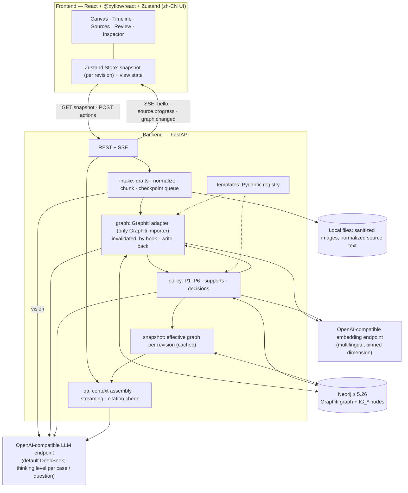

# 07 · Architecture

> Index: [README](README.md) · Depends on: [03](03-domain-model.md), [06](06-contradiction-policy.md) · Related: [08](08-data-contract-api.md), [13](13-setup.md)



## Module boundaries

| Module | Responsibility | Must not |
| :--- | :--- | :--- |
| `graph` | The only module importing `graphiti_core`. Builds clients, calls `add_episode`, runs the `invalidated_by` hook and write-back, and reads raw graph data | Hold policy logic |
| `intake` | Drafts, normalization, chunking, checkpoints, the per-case FIFO worker | Call Graphiti directly |
| `policy` | P1–P6, supports and excerpt location, decisions, undo | Import Graphiti types |
| `snapshot` | Builds and caches the effective graph per revision; publishes `graph.changed` | Write data |
| `qa` | Context assembly from the cached snapshot, streaming, citation checks | Query Graphiti search |
| `templates` | Pydantic template schema and registry | Contain executable logic |
| `api` | FastAPI routes; the source of the OpenAPI schema | Contain business logic |

**Shared contract.** The frontend types are generated from the backend's OpenAPI schema. SSE payloads use one shared schema module.

## Key decisions

| Decision | Rationale |
| :--- | :--- |
| Single store: Neo4j ≥ 5.26, **no APOC** | Graphiti does not support Postgres. The pinned Graphiti code path makes no APOC calls. |
| Graphiti's default vector search (cosine similarity over stored embeddings), with no vector-index setup | This is what 0.31.2 does. The embedding model and dimension are pinned per database, and changing either requires re-embedding. |
| `graphiti-core==0.31.2` pinned behind the `graph` adapter | The `invalidated_by` hook and write-back depend on internals. Contract tests guard upgrades. |
| One ingestion worker, one chunk at a time | Graphiti expects sequential `add_episode` calls per graph. Serial processing makes P1 capture and write-back race-free. |
| A revision is published after each chunk's policy, and after each analyst mutation | Clients never see raw Graphiti changes before the policy has run. |
| `graph.changed {version}` plus a snapshot refetch, instead of graph deltas | A local snapshot is ≤ 1 MB. This avoids a delta reducer, tombstones and replay logic. Typed deltas are a measured optimization for later. |
| Snapshot cached per revision; Q&A reads the same cache | No duplicate graph reads; Q&A context is consistent with what the analyst sees. |
| Timeline and paths run in the frontend | The case fits in memory, and both use the same time semantics. |
| Vision runs before Graphiti | Graphiti's ingestion API is text-only. |

## Integration notes (each verified in M0)

* **Graphiti LLM.** Configure it as follows:

  ```python
  OpenAIGenericClient(
      config=LLMConfig(api_key=…, base_url=…, model=…),
      structured_output_mode="json_object",
  )
  ```

  * **`json_object` is required.** DeepSeek's Chat Completions API supports only `text` and `json_object`; there is no `json_schema`.
  * **Graphiti uses one model.** This client does not route requests to `small_model`.
  * IntelGraph's own calls go through the OpenAI SDK; P2 classification may use `LLM_SMALL_MODEL`.
* **Thinking levels.** DeepSeek enables thinking by default (effort `high`), so every call must state a level explicitly.
  * The backend's **provider profile** (`LLM_PROVIDER_PROFILE`) maps each level to request parameters. The DeepSeek profile is:

    | Level | Request parameter |
    | :--- | :--- |
    | `off` | `extra_body={"thinking": {"type": "disabled"}}` |
    | `low` / `medium` / `high` | `extra_body={"reasoning_effort": <level>}` |

    All of these were accepted during environment setup.
  * A profile can declare that it has no thinking support. The UI then hides the selectors.
  * Graphiti's `OpenAIGenericClient` sends neither parameter. The adapter subclasses it and injects `extra_body` from the running job's extraction level.
  * In thinking mode the provider ignores `temperature`, so results vary more.
  * Extraction under any level other than `off` must keep producing valid `json_object` output. This is verified per level in M0.
  * Vision transcription always runs with `off`.
* **Language.** Graphiti appends a "use the same language as the source" instruction. The adapter overrides it so that fact text and summaries are zh-CN while entity names keep their native form. The planned approach is to wrap the client's language hook. Verify it with one Chinese and one English chunk.
* **Embedder.** Use `OpenAIEmbedder` against a multilingual endpoint. The default is Alibaba Bailian `qwen3.7-text-embedding`, at 1024 dimensions, served on the OpenAI-compatible path `/compatible-mode/v1` (not DashScope's native `/api/v1`).
  * Graphiti does not send a `dimensions` argument; it truncates vectors to `EMBEDDING_DIM`. The model's **native** output dimension must therefore equal `EMBEDDING_DIM`.
  * Pin both the model and the dimension.
* **Cross-encoder.** Inject an order-preserving stub that implements `CrossEncoderClient`. This means no OpenAI key is needed. IntelGraph does not use Graphiti's search scoring.
* **Excerpt location.** After each chunk, `policy` embeds the chunk's sentences once. For each new support, the sentence nearest to the fact text becomes the excerpt (`located: "auto"`). If no sentence passes the threshold, the whole chunk is used (`located: "none"`). No LLM call is involved.
* **Full-text search.** Graphiti creates its full-text indexes with the default analyzer. Benchmark Chinese recall in M0. If needed, recreate only the named indexes with Neo4j's `cjk` analyzer.
* **Telemetry.** Graphiti telemetry is on by default. Set `GRAPHITI_TELEMETRY_ENABLED=false` before Graphiti is imported.
* **Case isolation.** Every adapter call passes `group_id` explicitly, and the adapter rejects any call without one. Every API resource is scoped to and checked against its case.
* **Vision.** Call it directly through the OpenAI SDK with `image_url` parts. DeepSeek documents vision support; check OCR quality and limits in M0.

## Run modes

| Mode | Behaviour | Purpose |
| :--- | :--- | :--- |
| `live` | Full pipeline | Real use |
| `fixture` | **Read-only.** Serves frozen snapshots and evidence from `fixtures/`, plus a scripted `source.progress` / `graph.changed` sequence and recorded Q&A streams. Mutation endpoints return `501`, and the UI disables them. No Neo4j or LLM is needed. | Frontend development, read-path E2E tests, reliable demos |
