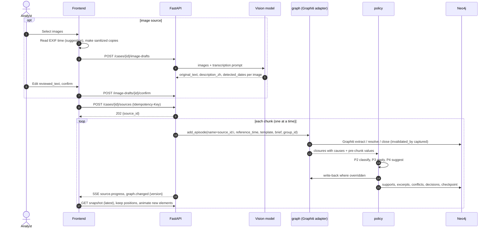

# F1 · Source Intake

> Index: [README](../README.md) · Depends on: [04](../04-sources-and-tiers.md), [06](../06-contradiction-policy.md), [08](../08-data-contract-api.md)

## Requirements

* **Create case.** Name, template and version, time zone, and story anchor (story mode only).
* **Case brief.** Editable at any time via `PUT /cases/{id}/brief`. Each version is kept. Changes apply only to jobs started afterwards.
* **Add a document or note.**
  * Fields: title, `source_type` (sets the default tier), tier (can be overridden), `reference_time` (required), and optionally speaker, URL and notes. Notes also have the speculation checkbox.
  * The client sends an `Idempotency-Key`. Repeating the same key returns the same source.
  * If the case already holds identical normalized content, the request returns `409 duplicate_source` with the existing source's ID.
* **Add images** through an image draft ([04](../04-sources-and-tiers.md)):
  1. upload the sanitized copies;
  2. transcribe;
  3. review;
  4. confirm, which creates the Source.

  The draft card shows `uploading → transcribing → awaiting_review` (or `failed`) and survives a page reload.
* **Normalization and chunking.**
  * Text is normalized: NFC Unicode, unified line breaks, trimmed whitespace.
  * Maximum 200,000 characters per source.
  * Chunks are about 1,500 tokens on paragraph boundaries. A paragraph that is too long is split at sentence boundaries.
  * Each chunk stores its character offsets in the normalized text.
* **Ingestion job.** The template version, the brief version and the extraction and classification thinking levels are pinned when the job starts. They are recorded for each chunk. The job runs one chunk at a time:
  1. `add_episode(name="{source_id}:{chunk_index}", …)`
  2. P1–P4
  3. supports and excerpt location
  4. checkpoint
  5. publish a revision

  Each chunk therefore makes the graph grow visibly.
* **Progress.** The source status is `queued → parsing → extracting → applying_policy → committed`, with `partial` and `failed` as the other outcomes. `current_chunk`, `chunk_count` and `error` are stored durably and pushed as `source.progress`.
* **Resume** (`POST /sources/{id}/resume`):
  * Restarts from the first chunk that has no checkpoint.
  * If an episode named `{source_id}:{chunk_index}` already exists (Graphiti committed it, but the policy did not finish), `add_episode` is skipped and P1–P4 run again. The policy is idempotent per chunk.
  * Jobs interrupted by a server restart become `partial` or `failed`. They can be resumed.
* **Retries.** One retry budget per chunk: 2 attempts, with exponential backoff.
* **Latency.** One chunk takes several LLM calls, typically 10–60 s. The UI never blocks.
* **Entrance animation.** New elements fade in. If a revision adds more than 30 elements, they animate as one batch of 400 ms. No animation under reduced motion.

## Ingestion flow

